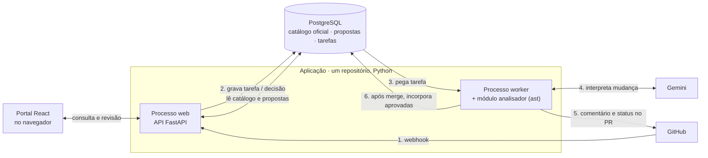

TCC · arquitetura revisada · 29/10/2026 · atualizada em 10/11/2026

# Mapa da arquitetura do TCC

Três peças, uma linguagem: uma **API** e um **worker**, os dois em Python, sobre um único **PostgreSQL**. O GitHub dispara a análise a cada PR, o bot comenta o resumo no PR, as propostas são revisadas no portal, e o merge incorpora o que foi aprovado.

## Decisões fechadas

| Tema | Versão inicial (.md) | Revisão de 29/10 | Atual (10/11) |
| --- | --- | --- | --- |
| Linguagem | API em Python, worker em Java, analisador em Python como subprocesso | Tudo em Python. O analisador é um módulo importado pelo worker. | Igual a 29/10. |
| Fila | RabbitMQ | Tabela `tarefas` no PostgreSQL | Igual a 29/10. |
| Aprovação | Revisão no portal, merge e PR de documentação separado | O bot faz commit da documentação no próprio PR. Aprovar é mergear. | O bot comenta e publica um status no PR. A revisão é no portal (aprovar, editar, rejeitar). Aprovação mais merge é a aceitação. |
| Documentação oficial | Repositório, com índice no banco | Repositório (junto com o código), com cópia no banco atualizada a cada merge | Banco. No repositório fica só o `.lastro.yml`. |
| Portal | Consulta e revisão | Só consulta (catálogo, histórico, grafo) | Consulta e revisão (catálogo, histórico, grafo, revisão). |
| Base inicial | — | Revisão no GitHub, mecanismo indefinido | Gerada na instalação da App; o bot abre um PR de ativação, e as regras são revisadas no portal. |
| Estilo | Dois serviços | Monólito modular com processamento assíncrono (web + worker) | Igual a 29/10. |

O motivo da revisão de 10/11 está em `requisitos.md` (D1+D2). Com a documentação na branch do PR, rejeitar uma proposta e pedir outra não fazia sentido, e havia conflitos entre as edições humanas e as novas análises. No portal, cada proposta tem uma decisão própria, e o bot não escreve mais nas branches dos desenvolvedores.

## Os três fluxos

Fluxo A · consulta e revisão

### Pessoa consulta ou revisa a documentação

1. Abre o portal React no navegador e faz login com o GitHub.
2. O portal chama a API.
3. A API lê o PostgreSQL e devolve JSON.
4. Quem tem permissão de escrita aprova, edita ou rejeita propostas. A API grava a decisão e uma tarefa para atualizar o status do PR.

Fluxo B · automático

### GitHub avisa que um PR mudou

1. O GitHub chama a API (webhook), que grava uma tarefa e responde.
2. O worker pega a tarefa, roda o AST e manda o contexto ao Gemini.
3. Grava as propostas no banco e comenta no PR um resumo com o link para o portal, mais o status `lastro/documentacao`.
4. O revisor decide as propostas no portal e faz o merge. No merge, as propostas aprovadas entram no catálogo.

Fluxo C · ativação

### A App é instalada em um repositório

1. O GitHub envia `installation`, e o worker gera a base inicial.
2. O bot abre o PR de ativação, com o `.lastro.yml` e o link para revisar o catálogo inicial no portal.
3. O merge desse PR torna a base vigente.
4. Se o PR for fechado sem merge, o repositório fica inativo. Reativa-se pelo portal ou pelo terminal, o que gera uma nova base e um novo PR.

## Diagrama



A API e o worker nunca se chamam diretamente. O banco é o ponto de encontro, inclusive para a fila.

## A vida de um PR, do começo ao fim

1. GitHub → API\
   Dev abre ou atualiza um PR (`opened` / `synchronize`). A API confere a assinatura e, numa única transação, grava o evento e cria a tarefa `analisar_pr`. Responde ao GitHub em poucos milissegundos.
2. Worker\
   O worker reserva a próxima tarefa pendente com um comando atômico (`FOR UPDATE SKIP LOCKED`) e marca como `processando`.
3. Worker → analisador\
   Baixa as duas versões do código e chama o analisador, que é um módulo Python comum. O `ast` aponta o que mudou, por exemplo `100` virou `150` numa condição.
4. Worker → Gemini\
   Envia só o trecho alterado, a regra atual e as vizinhas diretas no grafo. O Gemini diz se é mudança de negócio e propõe o novo texto.
5. Worker → GitHub\
   Grava as propostas no banco, comenta no PR o resumo com o link para o portal e publica o status `lastro/documentacao` como `pending`. Em novas análises, atualiza o mesmo comentário.
6. Revisor no portal\
   Vê o texto atual, o proposto e o código antes e depois. Aprova, edita ou rejeita (descartar ou refazer com motivo). Quando tudo está decidido, o status vira `success`.
7. GitHub → API → Worker\
   O merge (`closed` com `merged: true`) gera a tarefa `pr_mergeado`. O worker cria uma versão nova para cada regra aprovada. O portal já mostra a nova versão.

**Cuidados.** A aprovação sem merge não muda o catálogo. PR fechado sem merge descarta as decisões. Novos commits do dev geram nova análise; as decisões sobre funções que não mudaram são mantidas. Se o PR for mesclado com propostas pendentes, o portal mostra o catálogo como defasado até alguém revisá-las.

## A fila no PostgreSQL

Versão simplificada; a estrutura completa está na seção 4 de `arquitetura-tcc.md`.

```
CREATE TABLE tarefas (
  id              bigserial PRIMARY KEY,
  evento_id       bigint UNIQUE,          -- nulo nas tarefas do portal e do terminal
  repositorio_id  bigint NOT NULL,
  pull_request_id bigint,                 -- nulo em 'gerar_base' até o PR de ativação existir
  tipo            text NOT NULL,          -- 'gerar_base' | 'analisar_pr' | 'reanalisar_proposta'
                                          -- | 'atualizar_status' | 'pr_mergeado'
  commit_sha      text,
  status          text NOT NULL DEFAULT 'pendente',
  tentativas      int  NOT NULL DEFAULT 0,
  reserva_ate     timestamptz,
  erro            text,
  criado_em       timestamptz DEFAULT now()
);

-- worker reserva a próxima tarefa (atômico)
UPDATE tarefas
SET status = 'processando', tentativas = tentativas + 1,
    reserva_ate = now() + interval '5 minutes'
WHERE id = (
  SELECT id FROM tarefas
  WHERE status = 'pendente'
  ORDER BY id
  FOR UPDATE SKIP LOCKED
  LIMIT 1
)
RETURNING *;
```

| Risco | Como a tabela resolve |
| --- | --- |
| Dois workers pegarem a mesma tarefa | `FOR UPDATE SKIP LOCKED` num único `UPDATE`, com commit imediato |
| GitHub mandar o mesmo evento duas vezes | `delivery_id UNIQUE` em `eventos`, com `ON CONFLICT DO NOTHING` |
| Evento gravado mas tarefa não criada | Os dois na mesma transação |
| Worker cair no meio | A reserva expira em 5 min (renovada a cada 1 min enquanto o worker vive) e a tarefa volta para `pendente` |
| Falha no Gemini ou no GitHub | Até 5 tentativas com espera crescente e depois `erro`. Etapas externas são idempotentes. |

## Como descrever no TCC

**Monólito modular com processamento assíncrono**: um processo web (API e webhooks) e um processo worker, no mesmo repositório, sobre o mesmo PostgreSQL. Não é microsserviço, porque os processos compartilham banco e código. Essa é uma escolha consciente para o escopo.

### Por que não microsserviços

Exigiria banco próprio por serviço, deploy independente e comunicação por eventos. Isso traria de volta um broker e a consistência entre bancos, sem ganho para o volume de um TCC. Pode entrar como trabalho futuro.

### Por que não RabbitMQ

Com um worker e poucos tipos de tarefa, a tabela oferece as mesmas garantias e ainda permite gravar evento e tarefa na mesma transação. Um broker passa a valer a pena com volume alto, vários workers ou vários consumidores do mesmo evento.

### Por que tudo em Python

O `ast` é da biblioteca padrão do Python. Com o worker na mesma linguagem, o analisador é só um `import`. Somem o subprocesso, o contrato JSON entre linguagens e as duas camadas de acesso ao banco.

## Histórico de ajustes no .md

### Revisão de 29/10/2026

| Seção | Ajuste |
| --- | --- |
| Abertura e 1. Direção | Trocar “worker em Java” e “RabbitMQ” por worker Python e fila no PostgreSQL. Refazer o diagrama. Descrever como monólito modular. |
| 2. Tecnologias | Remover Java, JDBC, cliente Java e RabbitMQ. Worker usa SQLAlchemy, como a API. |
| 3. Integração Java e Python | Remover a subseção inteira. O analisador vira módulo importado. |
| 4. Recebimento e recuperação de falhas | Reescrever com a tabela `tarefas`: transação única, `SKIP LOCKED`, tentativas e retomada. Remover publisher confirm e dead letter. |
| 4. Eventos acompanhados | Ignorar `synchronize` gerado por commit do bot. `closed` com merge gera `pr_mergeado`. |
| 5. Adaptador de IA | Adaptador em Python, no worker. |
| 6. Artefatos publicados | Trocar o PR de documentação separado pelo commit no próprio PR. Banco recebe cópia após o merge. |
| 7. Organização do código | Módulos todos em Python. Portal sem revisão. |
| 8 e 9. Ordem e pendências | Remover itens de Java, RabbitMQ, contrato entre linguagens e login de revisor no portal. |

### Revisão de 10/11/2026 (aplicada)

| Seção | Ajuste |
| --- | --- |
| Abertura e 1. Direção | Portal de consulta e revisão; banco como fonte oficial; fluxos de ativação e de revisão. |
| 4. Eventos e permissões | Eventos `installation` e `installation_repositories`; sem filtro de commit do bot; Commit statuses; escrita em Contents só para o PR de ativação. Novos tipos de tarefa. |
| 5. Adaptador de IA | Contexto de um nível; refazer proposta com o motivo do revisor. |
| 6. Armazenamento e revisão | Reescrita: ativação, comentário e status no PR, revisão no portal, incorporação das aprovadas. |
| 7. Modelo de dados | Catorze entidades: entram `sessoes`, `etapas_tarefa` e `decisoes`; `tarefas.evento_id` opcional. |
| 9. Ordem | Incremento 5 passa a ser revisão no portal e incorporação; 6, portal de consulta. |
| 10. Pendências | Decisões D1–D16 de `requisitos.md` movidas para resolvidas. |
