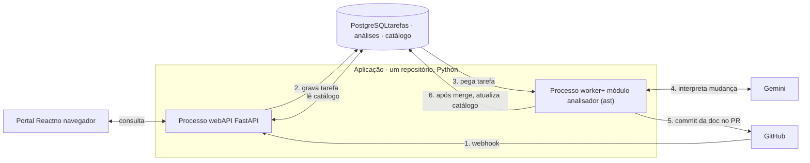

TCC · arquitetura revisada · 29/10/2026

# Mapa da arquitetura do TCC

Três peças, uma linguagem: uma **API** e um **worker**, os dois em Python, sobre um único **PostgreSQL**. O GitHub dispara a análise a cada PR, e a documentação é aprovada no próprio PR.

## Decisões fechadas

| Tema | Antes (.md) | Agora |
| --- | --- | --- |
| Linguagem | API em Python, worker em Java, analisador em Python como subprocesso | Tudo em Python. O analisador é um módulo importado pelo worker. |
| Fila | RabbitMQ | Tabela `tarefas` no PostgreSQL |
| Aprovação | Revisão no portal, merge e PR de documentação separado | O bot faz commit da documentação no próprio PR. Aprovar é mergear. |
| Documentação oficial | Repositório, com índice no banco | Repositório (junto com o código), com cópia no banco atualizada a cada merge |
| Portal | Consulta e revisão | Só consulta (catálogo, histórico, grafo) |
| Estilo | Dois serviços | Monólito modular com processamento assíncrono (web + worker) |

## Os dois fluxos

Fluxo A · leitura

### Pessoa consulta a documentação

1. Abre o portal React no navegador.
2. O portal chama a API.
3. A API lê o PostgreSQL e devolve JSON.

Fluxo B · automático

### GitHub avisa que um PR mudou

1. O GitHub chama a API (webhook), que grava uma tarefa e responde.
2. O worker pega a tarefa, roda o AST e manda o contexto ao Gemini.
3. Faz commit da documentação nova no próprio PR.
4. O revisor aprova o PR e, no merge, o banco é atualizado.

## Diagrama

Fluxo A (leitura)Fluxo B (automático)



A API e o worker nunca se chamam diretamente. O banco é o ponto de encontro, inclusive para a fila.

## A vida de um PR, do começo ao fim

1. GitHub → API\
   Dev abre ou atualiza um PR (`opened` / `synchronize`). A API confere a assinatura e, numa única transação, grava o evento e cria a tarefa `analisar_pr`. Responde ao GitHub em poucos milissegundos.
2. Worker\
   O worker reserva a próxima tarefa pendente com um comando atômico (`FOR UPDATE SKIP LOCKED`) e marca como `processando`.
3. Worker → analisador\
   Baixa as duas versões do código e chama o analisador, que é um módulo Python comum. O `ast` aponta o que mudou, por exemplo `100` virou `150` numa condição.
4. Worker → Gemini\
   Envia só o trecho alterado, a regra atual e as dependências. O Gemini diz se é mudança de negócio e propõe o novo texto.
5. Worker → GitHub\
   Gera o JSON e o Markdown e faz commit na branch do PR, com um comentário curto explicando a mudança. Antes, confere se já existe commit do bot para aquele `commit_sha`, para não duplicar.
6. Revisor no GitHub\
   Vê código e documentação lado a lado em “Files changed”. Comenta ou edita o texto se discordar. Aprova o PR se concordar.
7. GitHub → API → Worker\
   O merge (`closed` com `merged: true`) gera a tarefa `pr_mergeado`. O worker lê a documentação que entrou e atualiza o catálogo no banco. O portal já mostra a nova versão.

**Cuidados.** O commit do bot gera um novo `synchronize`: o worker ignora commits feitos por ele mesmo. PR fechado sem merge não muda nada. Novos commits do dev geram nova análise e atualizam a documentação na branch.

## A fila no PostgreSQL

```
CREATE TABLE tarefas (
  id           bigserial PRIMARY KEY,
  tipo         text NOT NULL,          -- 'analisar_pr' | 'pr_mergeado'
  repo         text NOT NULL,
  pr_numero    int  NOT NULL,
  commit_sha   text,
  delivery_id  text UNIQUE,            -- X-GitHub-Delivery
  status       text NOT NULL DEFAULT 'pendente',
  tentativas   int  NOT NULL DEFAULT 0,
  iniciado_em  timestamptz,
  erro         text,
  criado_em    timestamptz DEFAULT now()
);

-- worker reserva a próxima tarefa (atômico)
UPDATE tarefas
SET status = 'processando', iniciado_em = now(), tentativas = tentativas + 1
WHERE id = (
  SELECT id FROM tarefas
  WHERE status = 'pendente'
  ORDER BY id
  FOR UPDATE SKIP LOCKED
  LIMIT 1
)
RETURNING *;
```

| Risco | Como a tabela resolve |
| --- | --- |
| Dois workers pegarem a mesma tarefa | `FOR UPDATE SKIP LOCKED` num único `UPDATE`, com commit imediato |
| GitHub mandar o mesmo evento duas vezes | `delivery_id UNIQUE` com `ON CONFLICT DO NOTHING` |
| Evento gravado mas tarefa não criada | Os dois na mesma transação |
| Worker cair no meio | Tarefa em `processando` com `iniciado_em` antigo volta para `pendente` |
| Falha no Gemini ou no GitHub | Nova tentativa até um limite (ex.: 3) e depois `erro`. Etapas externas são idempotentes. |

## Como descrever no TCC

**Monólito modular com processamento assíncrono**: um processo web (API e webhooks) e um processo worker, no mesmo repositório, sobre o mesmo PostgreSQL. Não é microsserviço, porque os processos compartilham banco e código. Essa é uma escolha consciente para o escopo.

### Por que não microsserviços

Exigiria banco próprio por serviço, deploy independente e comunicação por eventos. Isso traria de volta um broker e a consistência entre bancos, sem ganho para o volume de um TCC. Pode entrar como trabalho futuro.

### Por que não RabbitMQ

Com um worker e poucos tipos de tarefa, a tabela oferece as mesmas garantias e ainda permite gravar evento e tarefa na mesma transação. Um broker passa a valer a pena com volume alto, vários workers ou vários consumidores do mesmo evento.

### Por que tudo em Python

O `ast` é da biblioteca padrão do Python. Com o worker na mesma linguagem, o analisador é só um `import`. Somem o subprocesso, o contrato JSON entre linguagens e as duas camadas de acesso ao banco.

## O que muda no .md

| Seção | Ajuste |
| --- | --- |
| Abertura e 1. Direção | Trocar “worker em Java” e “RabbitMQ” por worker Python e fila no PostgreSQL. Refazer o diagrama. Descrever como monólito modular. |
| 2. Tecnologias | Remover Java, JDBC, cliente Java e RabbitMQ. Worker usa SQLAlchemy, como a API. |
| 3. Integração Java e Python | Remover a subseção inteira. O analisador vira módulo importado. |
| 4. Recebimento e recuperação de falhas | Reescrever com a tabela `tarefas`: transação única, `SKIP LOCKED`, tentativas e retomada. Remover publisher confirm e dead letter. |
| 4. Eventos acompanhados | Ignorar `synchronize` gerado por commit do bot. `closed` com merge gera `pr_mergeado`. |
| 5. Adaptador de IA | Adaptador em Python, no worker. |
| 6. Artefatos publicados | Trocar o PR de documentação separado pelo commit no próprio PR. Banco recebe cópia após o merge. |
| 7. Organização do código | Módulos todos em Python. Portal sem revisão. |
| 8 e 9. Ordem e pendências | Remover itens de Java, RabbitMQ, contrato entre linguagens e login de revisor no portal. |