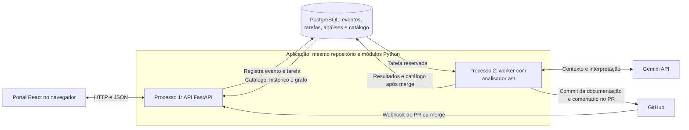

# TCC — Definição da arquitetura e implementação

Este documento consolida a arquitetura definida no [Mapa da arquitetura do TCC](<Mapa da arquitetura do TCC.md>) para implementar a aplicação de documentação viva descrita em [escopo-tcc.md](escopo-tcc.md).

As decisões são: **API e worker em Python**, **analisador como módulo importado pelo worker**, **fila de tarefas no PostgreSQL**, **um único banco**, **Gemini 3.6 Flash como IA**, **portal React somente para consulta** e **hospedagem da aplicação na Render, com PostgreSQL em uma oferta gratuita a definir**. A documentação será gravada na branch do próprio PR e revisada no GitHub. O merge incorpora código e documentação; depois dele, o worker atualiza a cópia consultada pelo portal.

Para o fluxo de revisão, esta definição adota a decisão do mapa: revisão e aprovação no GitHub. As referências à revisão pelo portal em `escopo-tcc.md` precisam ser alinhadas a essa decisão.

## 1. Direção da arquitetura

A aplicação será um **monólito modular com processamento assíncrono**: um processo web e um processo worker, no mesmo repositório, compartilhando módulos Python e o mesmo PostgreSQL.

| Processo | Responsabilidade |
|---|---|
| **1 — API Python/FastAPI** | Receber e validar webhooks, registrar eventos e tarefas e disponibilizar os endpoints de consulta do portal. |
| **2 — Worker Python** | Reservar tarefas no banco, obter versões do código, chamar o analisador, consultar o Gemini, publicar documentação e comentários no PR e sincronizar o catálogo após o merge. |

O analisador será um módulo Python importado pelo worker. A coordenação da análise, a interpretação pela IA e a publicação permanecem no mesmo processo para manter a implementação compatível com o escopo do TCC.

A API e o worker se coordenam pelas tarefas e pelos dados persistidos no PostgreSQL. O portal React executa no navegador e consulta a API por HTTP/JSON. A proposta inicial é servir seu build estático pela própria API; durante o desenvolvimento, o frontend poderá ter um servidor separado.



Serão **dois processos permanentes da aplicação e uma instância PostgreSQL**. A fila será uma tabela do próprio banco. Inicialmente, um worker executará uma tarefa por vez.

Essa separação permite receber e registrar tarefas durante uma parada do worker, desde que a API e o banco estejam disponíveis. A indisponibilidade do PostgreSQL interrompe recebimento, consultas e processamento. Uma falha no worker interrompe temporariamente análise, publicação e atualização do catálogo. Esses limites são aceitos nesta etapa, com recuperação de tarefas e backup do banco previstos na implementação.

### Fluxo de consulta

1. Uma pessoa abre o portal React.
2. O portal solicita o catálogo, o histórico ou o grafo à API.
3. A API consulta o PostgreSQL e devolve JSON.

### Fluxo de atualização

1. O GitHub avisa que um PR foi aberto ou atualizado.
2. A API valida a entrega e grava o evento e a tarefa na mesma transação.
3. O worker reserva a tarefa e analisa as versões do código com `ast`.
4. O Gemini interpreta o contexto e propõe a atualização das regras.
5. O worker gera JSON e Markdown e faz commit na branch do próprio PR, acompanhado de um comentário explicativo.
6. O revisor confere código e documentação no GitHub e pode editar os arquivos ou solicitar ajustes.
7. O merge representa a aceitação da versão final. Um novo evento gera a sincronização da documentação incorporada com o banco.

## 2. Tecnologias definidas e propostas de implementação

| Parte | Tecnologia | Responsabilidade |
|---|---|---|
| Linguagem do servidor | Python estável mais recente | Executar API, worker e analisador, com versão fixada para reproduzir os experimentos. |
| API — processo 1 | FastAPI | Receber webhooks e atender as consultas do portal. |
| Worker — processo 2 | Python | Consultar a fila no banco e executar o pipeline de análise, publicação e sincronização. |
| Análise estática | Biblioteca padrão `ast` | Extrair estrutura, comparar versões, identificar dependências e selecionar contexto. |
| Acesso às versões | Git e API do GitHub | Obter arquivos, commits e informações dos PRs. |
| Integração com IA | Gemini 3.6 Flash pela Gemini API, com adaptador Python | Preparar requisições, tratar falhas e validar respostas estruturadas. |
| Persistência | Uma instância PostgreSQL com um banco + SQLAlchemy | Armazenar eventos, tarefas, análises, propostas, métricas e cópias das versões publicadas. |
| Fila de processamento | Tabela `tarefas` no PostgreSQL | Reservar trabalho, controlar tentativas e recuperar tarefas interrompidas. |
| Portal | React; Vite proposto para desenvolvimento e build | Consultar catálogo, histórico e grafo. |
| Visualização do grafo | Cytoscape.js | Apresentar dependências e módulos envolvidos nas mudanças. |

O [SQLAlchemy](https://docs.sqlalchemy.org/en/20/orm/quickstart.html) será utilizado pelos dois processos, com os mesmos modelos e uma única sequência de migrações. Registrar evento e tarefa na mesma transação elimina a janela entre persistir o recebimento e encaminhar o trabalho a outra infraestrutura.

O [guia do React apresenta o Vite como uma opção de build](https://react.dev/learn/build-a-react-app-from-scratch). Os arquivos gerados poderão ser servidos com os [arquivos estáticos do FastAPI](https://fastapi.tiangolo.com/tutorial/static-files/), configurando o fallback das rotas da SPA. O grafo utilizará [Cytoscape.js](https://js.cytoscape.org/).

A fila no banco atende à proposta inicial de um worker e poucos tipos de tarefa. Essa escolha reduz a infraestrutura, mas exige implementar reserva, tentativas, recuperação e acompanhamento das tarefas. Seu comportamento será verificado antes dos experimentos.

## 3. Núcleo de análise com `ast`

### Versão da aplicação e código analisado

API, worker e analisador usarão a **versão estável mais recente do Python**, com a versão exata e as dependências fixadas no ambiente. Na consulta de **29/10/2026**, a versão disponível é o **Python 3.15.2**, publicado em 25/10/2026. A compatibilidade das bibliotecas será verificada na implementação. [Downloads oficiais do Python](https://www.python.org/downloads/) e [Python 3.15.2](https://www.python.org/downloads/release/python-3152/).

Os repositórios analisados terão como alvo **Python 3**. A versão usada para executar a ferramenta é diferente da versão do projeto analisado: o código será lido como texto, sem instalar ou executar suas dependências.

**A política de compatibilidade está definida:** usar o `ast` da versão instalada para analisar código da versão atual e de versões anteriores do Python 3, desde que a sintaxe seja aceita e as estruturas sejam tratadas pelo analisador.

Isso não garante suporte automático a toda versão desde a 3.0: uma sintaxe antiga pode ter deixado de ser aceita. O `ast.parse(feature_version=...)` permite tentar uma gramática anterior dentro dos limites do runtime, sem reproduzir exatamente o parser original. O código será submetido ao parser; incompatibilidades ou estruturas não tratadas serão registradas como limitação e análise incompleta, sem serem classificadas como ausência de mudança de negócio. Os testes documentarão os casos aceitos por essa política. [Compatibilidade do parser `ast`](https://docs.python.org/3/library/ast.html#ast.parse).

### Etapas da análise

A biblioteca `ast` transforma o texto do código em uma árvore de sintaxe abstrata. O analisador poderá identificar funções, classes, condições, chamadas, retornos e importações sem executar o projeto. [Documentação do `ast`](https://docs.python.org/3/library/ast.html).

1. **Extração:** identificar módulos, funções, métodos, classes e referências.
2. **Comparação:** localizar inclusões, remoções e alterações estruturais entre as versões.
3. **Seleção de contexto:** reunir código anterior e novo, regras existentes e dependências relevantes.
4. **Interpretação pelo Gemini:** avaliar se existe mudança de negócio e propor a atualização correspondente.
5. **Validação:** conferir o formato da resposta e suas referências ao código.

O núcleo estático será um módulo Python comum, com entradas e resultados estruturados, importado pelo worker e reutilizável pelo terminal e pelo replay. O módulo receberá versões de código e documentação existente; acesso ao GitHub, persistência e chamadas ao Gemini ficarão nos adaptadores coordenados pelo pipeline.

### Exemplo

Código anterior:

```python
if valor_compra >= 100:
    desconto = 0.10
```

Código alterado:

```python
if valor_compra >= 150:
    desconto = 0.10
```

A comparação identifica a troca de `100` por `150` na condição. O Gemini recebe os trechos e a regra existente e pode propor:

> O desconto de 10% passa a ser concedido para compras a partir de R$ 150.

A análise também precisa considerar alterações fora das funções, como constantes e importações. Uma função pode manter o texto e mudar de comportamento porque uma constante utilizada por ela foi alterada.

### Limites da análise estática

O `ast` não determina sozinho o significado de negócio de uma alteração nem resolve todas as dependências de Python. A proposta é construir um grafo de importações e chamadas resolvidas estaticamente, registrando as relações desconhecidas como limitação.

Uma dependência indica possível impacto, mas não comprova mudança de regra de negócio. Uma alteração estrutural também pode representar uma refatoração sem mudança de comportamento. A interpretação da IA continuará sujeita à revisão humana e à avaliação do TCC.

## 4. Integração com o GitHub e processamento assíncrono

### GitHub App

A integração será feita por uma **GitHub App**, instalada nos repositórios acompanhados e autorizada a consultar código, publicar documentação e comentar nos PRs.

- **Webhook:** informa à API que um evento aconteceu.
- **API do GitHub:** permite ao worker obter versões, consultar PRs e publicar os resultados.

O GitHub apresenta esse fluxo em seu [tutorial de aplicação que responde a webhooks](https://docs.github.com/en/apps/creating-github-apps/writing-code-for-a-github-app/building-a-github-app-that-responds-to-webhook-events).

### Eventos acompanhados

| Ação de `pull_request` | Tratamento |
|---|---|
| `opened` | Criar a tarefa `analisar_pr` para a versão recebida. |
| `synchronize` | Criar `analisar_pr` quando houver nova versão do código; reconhecer a atualização gerada apenas pelo commit de documentação do bot para evitar um ciclo. |
| `reopened` | Verificar a versão atual e criar `analisar_pr` quando necessário. |
| `closed` com `merged: true` | Criar `pr_mergeado` para importar a documentação efetivamente incorporada. |
| `closed` sem merge | Registrar o encerramento e descartar análises pendentes que perderam a finalidade; manter o catálogo vigente. |

Os eventos e seus campos estão na [documentação de payloads do GitHub](https://docs.github.com/en/webhooks/webhook-events-and-payloads#pull_request).

O controle dos eventos do bot deve conferir a identidade do app, o commit publicado e os arquivos alterados. Um evento só será ignorado como atualização própria quando corresponder à documentação produzida pela ferramenta. Commits humanos ou alterações de código precisam continuar gerando análise.

### Recebimento transacional

1. O GitHub envia a requisição para `POST /webhooks/github`.
2. A API valida a assinatura, identifica a instalação, o repositório, a ação, o PR e os commits envolvidos.
3. Em **uma única transação PostgreSQL**, registra o evento e cria a tarefa correspondente, com uma restrição de unicidade para `X-GitHub-Delivery` no registro do evento. Eventos ignorados também podem ser registrados com o motivo, sem gerar tarefa.
4. Depois do commit da transação, responde com sucesso ao GitHub. Uma entrega já persistida é reconhecida sem criar outra tarefa.

Se a transação falhar, evento e tarefa não serão confirmados e a API retornará falha. Se a resposta se perder depois do commit, o reenvio será deduplicado. O recebimento deve terminar em até dez segundos, sem executar AST ou chamadas à IA na requisição. [Boas práticas para webhooks](https://docs.github.com/en/webhooks/using-webhooks/best-practices-for-using-webhooks).

O GitHub **não reenvia automaticamente entregas com falha**. Inicialmente, será previsto reenvio manual e conferência das entregas; a automação da reconciliação poderá ser acrescentada aos processos existentes. [Tratamento de entregas com falha](https://docs.github.com/en/webhooks/using-webhooks/handling-failed-webhook-deliveries).

### Fila no PostgreSQL

A tabela `tarefas` armazenará o tipo de operação, sua origem, os commits, o estado de processamento, as tentativas e os erros. A estrutura abaixo é uma referência para a implementação; os demais dados da instalação e do evento poderão ser obtidos pelo registro de origem.

```sql
CREATE TABLE tarefas (
    id              bigserial PRIMARY KEY,
    tipo            text NOT NULL, -- 'analisar_pr' | 'pr_mergeado'
    repo            text NOT NULL,
    pr_numero       integer NOT NULL,
    commit_sha      text,
    base_sha        text,
    delivery_id     text UNIQUE,
    status          text NOT NULL DEFAULT 'pendente',
    tentativas      integer NOT NULL DEFAULT 0,
    disponivel_em   timestamptz NOT NULL DEFAULT now(),
    iniciado_em     timestamptz,
    reserva_ate     timestamptz,
    reserva_token   uuid,
    erro            text,
    criado_em       timestamptz NOT NULL DEFAULT now()
);

CREATE INDEX tarefas_pendentes_idx
    ON tarefas (disponivel_em, id)
    WHERE status = 'pendente';

-- Reservar uma tarefa em uma transação curta e confirmar imediatamente.
UPDATE tarefas AS tarefa
SET status = 'processando',
    iniciado_em = now(),
    tentativas = tarefa.tentativas + 1,
    reserva_ate = now() + interval '5 minutes',
    reserva_token = gen_random_uuid()
WHERE tarefa.id = (
    SELECT id
    FROM tarefas
    WHERE status = 'pendente'
      AND disponivel_em <= now()
    ORDER BY disponivel_em, id
    LIMIT 1
    FOR UPDATE SKIP LOCKED
)
RETURNING tarefa.*;
```

O worker consultará periodicamente as tarefas disponíveis, com intervalo configurável quando a fila estiver vazia. A reserva usa `FOR UPDATE SKIP LOCKED`, que permite pular linhas já bloqueadas por outro consumidor. A transação será encerrada antes da análise e das chamadas externas. O PostgreSQL documenta esse uso para tabelas que funcionam como filas. [Bloqueio de linhas e `SKIP LOCKED`](https://www.postgresql.org/docs/current/sql-select.html#SQL-FOR-UPDATE-SHARE).

Os estados previstos são `pendente`, `processando`, `concluida`, `erro` e `descartada`. A conclusão será registrada no banco junto aos resultados da etapa. A unicidade de `delivery_id`, com tratamento de conflito na inserção, impedirá a criação de outra tarefa para a mesma entrega.

### Recuperação de falhas e novas tentativas

| Situação | Comportamento esperado |
|---|---|
| Entrega repetida | Reconhecer o evento existente e manter a tarefa já criada. |
| Worker cai durante a execução | Recuperar a tarefa após expirar a reserva, retomando as etapas ainda necessárias. |
| Análise salva, mas publicação falha | Reutilizar o resultado persistido e tentar novamente a publicação. |
| Commit feito, mas resposta ou registro local se perde | Consultar o GitHub e reconhecer a publicação antes de criar outro commit ou comentário. |
| Gemini ou GitHub indisponível | Reagendar com `disponivel_em`, intervalo entre tentativas e limite configurável. |
| Limite esgotado | Marcar como `erro`, preservar o histórico e permitir reprocessamento operacional após a correção. |
| PR atualizado ou fechado durante a análise | Conferir o estado atual antes de publicar e descartar ou substituir o trabalho obsoleto. |

A reserva terá prazo e identificação da tentativa. O worker deverá renová-la enquanto estiver ativo; na inicialização e periodicamente, verificará reservas expiradas para reagendar tarefas ou marcá-las como `erro` quando o limite de tentativas tiver sido atingido. Atualizações de conclusão e renovação devem conferir `reserva_token` e o estado atual, para que uma execução antiga não conclua uma tarefa já retomada. Os cinco minutos do exemplo são ilustrativos; os prazos serão definidos com os tempos limite das etapas.

O banco e o GitHub não participam da mesma transação. Por isso, o processamento deve tolerar repetição. A deduplicação da análise considerará repositório, PR, commits comparados e configuração da execução; a publicação terá identificação estável vinculada à análise e ao commit de origem.

As etapas e tentativas ficarão registradas no PostgreSQL. Esse histórico permitirá acompanhar recebimento, análise, chamadas ao Gemini, publicação, erros e sincronização após o merge.

### Autenticação e permissões

O worker usará a chave privada do GitHub App para solicitar um token de instalação e atuar nos repositórios autorizados. [Autenticação da instalação](https://docs.github.com/en/apps/creating-github-apps/authenticating-with-a-github-app/authenticating-as-a-github-app-installation).

As permissões previstas são:

- **Contents — leitura e escrita:** obter o código e gravar os artefatos de documentação na branch do PR.
- **Pull requests — leitura e escrita:** consultar PRs e publicar comentários.

Comentários gerais de PR utilizam as operações de comentários de issues. [API de comentários](https://docs.github.com/en/rest/issues/comments).

O fluxo automático pressupõe que a instalação tenha permissão de escrita na branch de origem. O tratamento de PRs de forks e branches com restrições será definido na implementação; falta de permissão deverá ser registrada e informada no PR, sem apresentar a documentação como publicada.

O portal será de consulta. Se houver repositórios privados, o controle de acesso de leitura ainda precisará ser definido. Segredos do GitHub, do Gemini e do banco permanecerão nos componentes do servidor.

### Desenvolvimento local e hospedagem

No desenvolvimento, os webhooks poderão ser encaminhados para a API local com uma ferramenta como a utilizada no [tutorial oficial do GitHub](https://docs.github.com/en/apps/creating-github-apps/writing-code-for-a-github-app/building-a-github-app-that-responds-to-webhook-events). Em operação contínua, a API precisará de um endereço público HTTPS.

A **Render foi escolhida para hospedar a aplicação**. A API será um serviço web e o worker será um processo de processamento em segundo plano. O PostgreSQL utilizará uma oferta gratuita, cujo provedor ainda será definido. O build estático do React permanece proposto para publicação junto à API. Migrações, reinício, persistência e backup serão configurados na implementação.

A escolha da Render não resolve o plano de execução: na consulta de 29/10/2026, seus workers dedicados não têm instância gratuita. O serviço web gratuito suspende por inatividade, o que pode comprometer o prazo de resposta do webhook na primeira requisição. Se o banco escolhido for o PostgreSQL gratuito da própria Render, ele expira após 30 dias. O plano do worker, a disponibilidade da API e a continuidade do banco precisam ser definidos antes da implantação. [Planos gratuitos da Render](https://render.com/docs/free) e [serviços de worker](https://render.com/docs/background-workers).

No desenvolvimento do React em outra origem, será necessário configurar encaminhamento à API ou [CORS](https://fastapi.tiangolo.com/tutorial/cors/).

## 5. Uso de LLM com Gemini

A IA escolhida é o **Gemini 3.6 Flash**, acessado pela Gemini API com o identificador `gemini-3.6-flash`, listado no [catálogo oficial de modelos](https://ai.google.dev/gemini-api/docs/models). A escolha do modelo está resolvida. O piloto utilizará esse modelo para avaliar qualidade, consumo e tempo e calibrar a configuração; suas cotas e o protocolo do piloto ainda serão definidos.

O nível gratuito dá acesso limitado a determinados modelos. Suas cotas precisam ser confrontadas com o volume previsto para o replay histórico. As condições estão nas páginas de [preços](https://ai.google.dev/gemini-api/docs/pricing) e [limites do Gemini](https://ai.google.dev/gemini-api/docs/rate-limits).

No nível gratuito, o conteúdo pode ser utilizado para melhorar os produtos. Essa condição deverá ser considerada se o estudo de caso envolver código privado. [Condições da API](https://ai.google.dev/gemini-api/docs/pricing).

### Adaptador de IA

O pipeline terá uma interface Python para interpretar mudanças, com o código específico do Gemini em um adaptador. Esse adaptador preparará a requisição, tratará erros e validará a resposta estruturada, contendo:

- Existência ou ausência de mudança de regra de negócio.
- Regras afetadas e referências ao código que sustentam a proposta.
- Tipo de atualização: inclusão, alteração ou remoção.
- Texto proposto para a documentação.

Conferir formato e referências não comprova a corretude semântica da resposta. As propostas serão revisadas no GitHub e avaliadas pelo protocolo do TCC.

### Consumo e reprodução dos experimentos

Serão enviados os trechos alterados e o contexto relevante, incluindo dependências e regras existentes quando necessário. Cada execução registrará modelo, versão do prompt, parâmetros, tokens e tempo. As chamadas terão tempo limite e novas tentativas controladas pela tarefa.

Modelo e configuração serão mantidos consistentes nas comparações. Mudanças deverão ser registradas para permitir interpretar os resultados.

## 6. Armazenamento, revisão e versionamento da documentação

O **repositório analisado será a fonte oficial da documentação**, versionada junto ao código. O PostgreSQL manterá a operação da ferramenta e uma cópia das versões incorporadas, usada para consulta pelo portal.

| Local | Conteúdo |
|---|---|
| Repositório analisado | Catálogo em JSON e Markdown, revisado e incorporado no mesmo PR do código. |
| PostgreSQL | Eventos, tarefas, etapas, tentativas, análises, propostas originais, métricas, histórico e cópia do catálogo incorporado. |

### Publicação no próprio PR

O worker gerará JSON e Markdown a partir da mesma proposta estruturada e fará commit apenas nos caminhos de documentação mantidos pela ferramenta. Publicará um comentário curto com o resumo, as referências e a indicação dos arquivos alterados.

O revisor verá código e documentação juntos no GitHub. Poderá aceitar a proposta, editar os arquivos ou solicitar correções antes do merge. **O merge será o marco de aceitação e publicação da versão final**; uma aprovação de revisão sem merge ainda não atualizará o catálogo vigente.

Antes de publicar, o worker verificará se o PR continua aberto e se sua versão corresponde à analisada. O commit terá como pai a versão conferida da branch, e sua atualização deverá ser feita sem forçar a referência. Se a branch tiver avançado, a publicação deverá ser reavaliada. O GitHub oferece atualização de referência com verificação de avanço, por meio de `force: false`. [Atualização de referências Git](https://docs.github.com/en/rest/git/refs#update-a-reference).

O histórico identificará a versão de código analisada e o commit de documentação criado pelo bot. Atualizações feitas por desenvolvedores gerarão nova análise; ajustes humanos à documentação deverão ser preservados ou apresentados como conflito para revisão, sem sobrescrita silenciosa.

### Sincronização após o merge

A tarefa `pr_mergeado` obterá o commit efetivamente incorporado à branch de referência, lerá os artefatos de documentação daquele commit e atualizará a cópia no banco. O conteúdo importado será a versão final do repositório, incluindo edições humanas feitas durante a revisão.

O commit incorporado deverá ser resolvido conforme o tipo de merge, incluindo merge comum, squash ou rebase. [Identificação do commit após o merge](https://docs.github.com/en/rest/pulls/pulls#get-a-pull-request).

A importação deverá ser idempotente e registrar repositório, PR, versão do código, versão da documentação e horário da sincronização. Tarefas de merges recebidas fora de ordem poderão acrescentar versões ao histórico, mas não deverão fazer o catálogo atual retroceder; a atualização verificará a relação entre os commits da branch de referência.

Um PR fechado sem merge preservará o catálogo vigente. Se um PR for incorporado com documentação ausente, inválida ou referente a uma análise desatualizada, a aplicação registrará a inconsistência para tratamento, sem apresentar aquela versão como sincronizada.

### Portal de consulta e histórico

O React consultará catálogo, origem das regras, histórico por PR e grafo por meio da API. O portal indicará a versão efetivamente sincronizada e a data da última atualização. Se o merge já ocorreu, mas sua tarefa ainda estiver pendente ou com erro, a defasagem deverá ser visível.

As propostas originais e os ajustes humanos serão preservados separadamente para a avaliação. O replay medirá a saída automática antes da intervenção humana.

## 7. Organização do código e reaproveitamento

| Módulo ou componente | Responsabilidade |
|---|---|
| API | Webhooks e endpoints de consulta do portal. |
| Processamento | Consulta e reserva de tarefas, controle de etapas, tentativas, recuperação e histórico operacional. |
| Análise | Extração de AST, comparação de versões, dependências e seleção de contexto. |
| IA | Preparação das solicitações, adaptador Gemini e validação das respostas. |
| Documentação | Propostas, geração de JSON e Markdown, importação após merge e histórico das versões. |
| GitHub | Validação de eventos, autenticação do app, consulta de versões e publicação de commits e comentários. |
| Persistência | Modelos SQLAlchemy, repositórios de dados e migrações compartilhadas. |
| Portal React | Consulta do catálogo, histórico e grafo. |
| Avaliação | Replay de PRs, linhas de base e coleta de métricas. |

API e worker terão pontos de entrada distintos e reutilizarão os módulos Python do mesmo projeto. O núcleo receberá versões de código e documentação existente sem depender do recebimento de webhooks.

O pipeline também poderá ser chamado pelo terminal e pelo replay histórico. Na avaliação, executará as mesmas etapas de análise e interpretação, com publicação no GitHub desabilitada e resultados registrados para comparação com o gabarito.

## 8. Ordem de implementação

1. **Analisador local:** fixar o Python, comparar duas versões pelo terminal, extrair estruturas e identificar alterações e dependências. Verificar a sintaxe dos projetos selecionados.
2. **Catálogo e Gemini:** gerar uma base inicial, integrar o Gemini 3.6 Flash, produzir propostas estruturadas e executar o piloto para avaliar o modelo e calibrar a configuração.
3. **Persistência e fila:** configurar PostgreSQL e SQLAlchemy, registrar evento e tarefa na mesma transação e implementar reserva, tentativas e recuperação do worker. Verificar duplicação de entregas, falha durante a análise e expiração de reservas.
4. **GitHub App e documentação no PR:** receber eventos, publicar JSON e Markdown na branch do PR e comentar os resultados. Verificar mudanças concorrentes, novas tentativas de publicação e prevenção de ciclos gerados pelo bot.
5. **Sincronização após merge:** importar a documentação efetivamente incorporada, preservar revisões humanas e manter o histórico sem regressão do catálogo atual. Verificar fechamento sem merge e diferentes formas de merge.
6. **Portal React:** implementar consultas de catálogo, histórico e grafo, indicação da versão sincronizada e publicação do build estático.
7. **Avaliação:** executar replay histórico e linhas de base, medindo detecção, corretude, atualização, tempo e consumo conforme o escopo.

O registro das métricas e configurações começará nas primeiras execuções. A geração da base inicial também precisará passar por revisão no GitHub antes de ser tratada como documentação vigente.

## 9. Decisões resolvidas, esclarecimentos e pontos em aberto

Os itens respondidos foram incorporados como decisões de arquitetura. A implementação e sua validação ocorrerão nas etapas correspondentes. Quando a resposta resolve apenas parte de um item, os detalhes restantes continuam em aberto.

### 9.1. Resolvidos

- **Modelo de IA — Gemini 3.6 Flash.** O worker utilizará `gemini-3.6-flash` pelo adaptador Python. O piloto avaliará essa escolha; a seleção do modelo deixou de ser uma pendência.
- **Compatibilidade do analisador — `ast` da versão instalada.** A ferramenta analisará código da versão atual e de versões anteriores do Python 3 que esse parser aceite. Casos incompatíveis ou não tratados serão informados como limitações. A política está definida na seção 3, sem pressupor que todo código antigo seja aceito.
- **Hospedagem — Render e PostgreSQL em oferta gratuita.** A Render está escolhida para os processos da aplicação, e o banco deverá usar uma oferta gratuita. O provedor do banco e os planos de execução ainda precisam ser definidos, conforme as condições explicadas na seção 4.

### 9.2. Esclarecimento: ferramentas e publicação do portal React

Esse item reúne as escolhas necessárias para desenvolver as telas, buscar os dados e colocar o portal no ar:

1. **Ferramentas:** são os programas usados para desenvolver e preparar o frontend para publicação. O Vite é a proposta atual: oferece o servidor de desenvolvimento e gera o build, um conjunto de arquivos HTML, CSS e JavaScript que o navegador carrega. [Build com Vite](https://vite.dev/guide/build.html).
2. **Navegação:** define como a pessoa passa entre catálogo, histórico e grafo, inclusive ao abrir um endereço diretamente. Por exemplo, `/catalogo` e `/historico` poderiam abrir telas diferentes; esses caminhos são ilustrativos e ainda serão definidos.
3. **Consultas à API:** definem como cada tela pede seus dados ao FastAPI e apresenta carregamento, resultado ou erro. Por exemplo, ao abrir o catálogo, o React poderia chamar `GET /api/regras`; a API consultaria o PostgreSQL e devolveria JSON para a tela. Esse endpoint também é ilustrativo.
4. **Publicação do build estático:** significa disponibilizar os arquivos gerados para que o navegador possa baixá-los. A proposta atual é servi-los pela própria API hospedada na Render. O servidor de desenvolvimento do Vite é usado durante o trabalho local; a publicação utiliza o build.

A dúvida sobre o significado do item fica esclarecida aqui. A escolha final das ferramentas, das rotas e da forma de publicação continua em aberto, pois ainda não foi definida na anotação.

### 9.3. Em aberto

- Cotas disponíveis para o Gemini 3.6 Flash e configuração do piloto.
- Critérios de seleção de contexto e resolução estática de dependências.
- Formato do catálogo, caminhos gerados e identificação estável das regras entre versões.
- Esquema final de eventos, tarefas e etapas; migrações, intervalo de consulta, duração e renovação das reservas, limites de tentativas e procedimento de reprocessamento.
- Identificação dos commits do bot, deduplicação por versão e preservação dos ajustes humanos à documentação.
- Tratamento de PRs de forks, permissões de escrita e restrições das branches.
- Reconciliação com a branch de referência quando novos commits ou merges tornarem uma análise desatualizada; tratamento de documentação inválida ou ausente após merge.
- Procedimento para selecionar e revisar a documentação inicial e manter seus artefatos JSON e Markdown consistentes após edições humanas.
- Controle de acesso de leitura no portal, caso acompanhe repositórios privados.
- Escolhas de implementação do React explicadas na seção 9.2: ferramentas, navegação, consultas à API e publicação do build estático.
- Provedor da oferta gratuita de PostgreSQL, plano do worker na Render, disponibilidade da API para receber webhooks, backup, reinício dos processos e recuperação de entregas com falha.

O primeiro incremento será o **analisador local que compara duas versões e produz diferenças estruturais e contexto**. Em seguida, o mesmo pipeline Python integrará o Gemini para propor a atualização da documentação e será reutilizado pelo worker e pelo replay.
