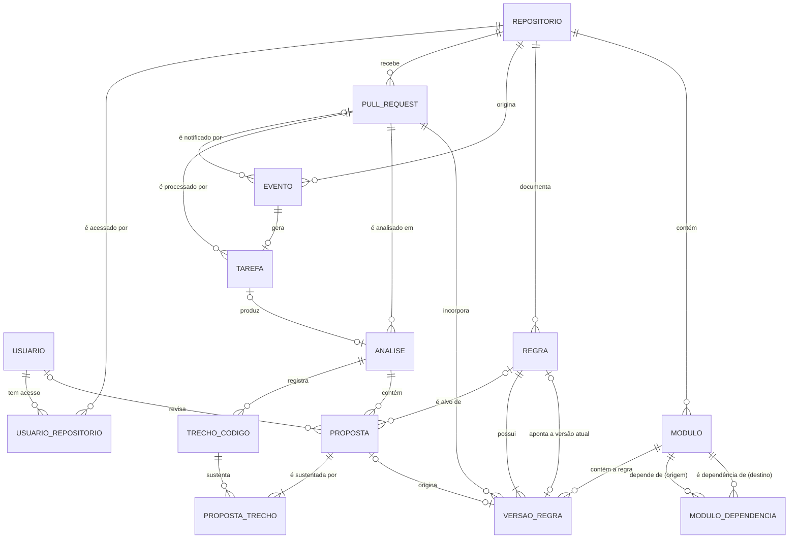

# Códice — Definição da arquitetura e implementação

Este documento consolida a arquitetura da plataforma **Códice**, aplicação de documentação viva de regras de negócio descrita em [escopo-tcc.md](escopo-tcc.md).

As decisões são: **API e worker em Python em um monólito modular plano**, **núcleo de análise estática (`analise/`) puro e importado diretamente**, **fila de tarefas no PostgreSQL**, **um único banco PostgreSQL como fonte oficial do catálogo (exportável em JSON e Markdown)**, **Gemini 3.6 Flash como IA**, **comentário no PR com resumo das alterações sugeridas e link direto para revisão no portal**, **portal React para consulta e revisão/aprovação com login pelo GitHub** e **hospedagem da aplicação na Render, com PostgreSQL em uma oferta gratuita a definir**.

No fluxo de revisão, o bot **não faz commit automático na branch do PR**: publica apenas o comentário resumido com o link para o portal. A aceitação, o ajuste ou a rejeição das propostas acontecem no portal, e as propostas aprovadas passam a compor o catálogo vigente quando o PR é incorporado (*merge*) à branch de referência.

## 1. Direção da arquitetura

A aplicação é um **monólito modular plano com processamento assíncrono**: um processo web e um processo worker, no mesmo repositório, compartilhando módulos Python diretos (sem camadas artificiais excessivas) e o mesmo PostgreSQL.

| Processo | Responsabilidade |
|---|---|
| **1 — API Python/FastAPI** | Receber e validar webhooks, registrar eventos e tarefas, autenticar as pessoas no portal pelo GitHub, expor endpoints de consulta (catálogo, histórico, grafo, exportação) e registrar decisões de revisão/aprovação de propostas. |
| **2 — Worker Python** | Reservar tarefas no banco, obter versões do código via GitHub, chamar o núcleo `analise/`, consultar o Gemini, publicar o comentário resumo + link no PR e efetivar propostas aprovadas no catálogo após o *merge*. |

O núcleo de análise (`analise/`) é um módulo Python puro (sem I/O), importado diretamente pelo worker, pela CLI e pelo experimento de replay. Os demais módulos (`catalogo/`, `processamento/`, `ia/`, `github/`, `avaliacao/`, `api/`, `db/`) organizam o código de forma plana por responsabilidade, utilizando SQLAlchemy 2 e Pydantic diretamente onde fazem sentido.

A API e o worker se coordenam pelas tarefas e pelos dados persistidos no PostgreSQL. O portal React executa no navegador e consulta/envia revisões à API por HTTP/JSON. A proposta inicial é servir seu build estático pela própria API; durante o desenvolvimento, o frontend utiliza o servidor do Vite com proxy `/api`.

```mermaid
flowchart LR
    PORTAL["Portal React (Consulta e Revisão)"]
    GH["GitHub (App + Webhooks)"]
    IA["Gemini 3.6 Flash API"]
    subgraph APP["Códice — Monólito Modular Python"]
        API["Processo 1: API FastAPI"]
        WORKER["Processo 2: Worker + Analisador AST"]
    end
    DB[("PostgreSQL 18\nEventos · Fila tarefas · Análises · Propostas · Catálogo")]

    PORTAL <-->|HTTP / JSON (Consulta e Aprovação)| API
    GH -->|Webhook PR / Merge| API
    API -->|Transação única: evento + tarefa| DB
    DB -->|FOR UPDATE SKIP LOCKED| WORKER
    WORKER <-->|Contexto mínimo + Propostas| IA
    WORKER -->|Comentário no PR: resumo + link p/ portal| GH
    WORKER -->|Propostas e incorporação pós-merge| DB
    DB -->|Catálogo, propostas, histórico e grafo| API
```

São **dois processos permanentes da aplicação e uma instância PostgreSQL**. A fila é uma tabela do próprio banco (`tarefas`). Inicialmente, um worker executa uma tarefa por vez.

Essa separação permite receber e registrar tarefas durante uma parada do worker, desde que a API e o banco estejam disponíveis. A indisponibilidade do PostgreSQL interrompe recebimento, consultas, revisões e processamento. Uma falha no worker interrompe temporariamente análise, comentários no PR e efetivação automática após *merge*. Esses limites são aceitos nesta etapa, com recuperação de tarefas e backup do banco previstos na implementação.

### Fluxo de consulta e revisão no portal

1. Uma pessoa abre o portal React (diretamente ou pelo link publicado no comentário do PR) e se autentica com sua conta do GitHub.
2. O portal solicita à API o catálogo vigente, as propostas pendentes de revisão, o histórico por PR ou o grafo de dependências.
3. A API verifica as permissões do usuário no repositório, consulta o PostgreSQL e devolve JSON.
4. Ao revisar uma proposta no portal, o revisor pode aceitá-la, ajustar seu texto ou rejeitá-la; a API persiste a decisão preservando a proposta original gerada pela IA.

### Fluxo automático de análise e incorporação

1. O GitHub notifica a API que um PR foi aberto ou atualizado (`opened`, `synchronize`, `reopened`).
2. A API valida a entrega e grava o evento e a tarefa `analisar_pr` na mesma transação.
3. O worker reserva a tarefa, obtém as versões do código via GitHub e executa a análise estática com `ast`.
4. O Gemini interpreta o contexto selecionado e devolve propostas estruturadas de inclusão, alteração ou remoção de regras.
5. O worker persiste a análise, os trechos de código e as propostas no PostgreSQL (com status `pendente`) e publica (ou atualiza) um **comentário no PR** contendo o resumo das mudanças propostas, referências ao código e o **link direto para revisão e aprovação no portal**.
6. O revisor analisa o código no GitHub e acessa o portal pelo link para aceitar, ajustar ou rejeitar cada proposta.
7. Quando o PR é incorporado à branch de referência (`closed` com `merged: true`), a tarefa `pr_mergeado` incorpora as propostas aprovadas/ajustadas ao catálogo vigente e atualiza o grafo de módulos no PostgreSQL. Um PR fechado sem *merge* não altera o catálogo vigente.

## 2. Tecnologias definidas e propostas de implementação

| Parte | Tecnologia | Responsabilidade |
|---|---|---|
| Linguagem do servidor | Python 3.15 (fixado em `backend/.python-version`, gerenciado com `uv`) | Executar API, worker, CLI e analisador, com versão fixada para reproduzir os experimentos. |
| API — processo 1 | FastAPI + Uvicorn | Receber webhooks, autenticar usuários, atender consultas e receber decisões de revisão do portal. |
| Worker — processo 2 | Python | Consultar a fila no banco e executar o pipeline de análise, publicação de comentário no PR e incorporação pós-merge. |
| Análise estática | Biblioteca padrão `ast` | Extrair estrutura, comparar versões, identificar dependências e selecionar contexto (módulo puro sem I/O). |
| Acesso às versões | Git e API REST do GitHub | Obter arquivos, commits e informações dos PRs (somente leitura no conteúdo). |
| Integração com IA | Gemini 3.6 Flash pela Gemini API (`google-genai`) | Preparar requisições, tratar falhas e validar respostas estruturadas. |
| Persistência e catálogo | PostgreSQL 18 + SQLAlchemy 2 + Alembic | Fonte oficial do catálogo (exportável em JSON/Markdown) e armazenamento de eventos, tarefas, análises, trechos, propostas, revisões e métricas. |
| Fila de processamento | Tabela `tarefas` no PostgreSQL | Reservar trabalho (`FOR UPDATE SKIP LOCKED`), controlar tentativas e recuperar tarefas interrompidas. |
| Portal | React 19 + TypeScript 7 + Vite 8 (`pnpm`) | Consultar catálogo, histórico e grafo e revisar/aprovar propostas de PR. |
| Visualização do grafo | Cytoscape.js | Apresentar dependências e módulos envolvidos nas mudanças. |

O [SQLAlchemy](https://docs.sqlalchemy.org/en/20/orm/quickstart.html) é utilizado pelos dois processos, com os mesmos modelos em `codice/db/modelos/` e uma única sequência de migrações Alembic. Registrar evento e tarefa na mesma transação elimina a janela entre persistir o recebimento e encaminhar o trabalho a outra infraestrutura.

O [guia do React apresenta o Vite como uma opção de build](https://react.dev/learn/build-a-react-app-from-scratch). Os arquivos gerados poderão ser servidos com os [arquivos estáticos do FastAPI](https://fastapi.tiangolo.com/tutorial/static-files/), configurando o fallback das rotas da SPA. O grafo utilizará [Cytoscape.js](https://js.cytoscape.org/).

A fila no banco atende à proposta inicial de um worker e poucos tipos de tarefa. Essa escolha reduz a infraestrutura, mas exige implementar reserva, tentativas, recuperação e acompanhamento das tarefas. Seu comportamento será verificado antes dos experimentos.

## 3. Núcleo de análise com `ast`

### Versão da aplicação e código analisado

API, worker e analisador usam **Python 3.15** (com versão exata e dependências fixadas via `backend/.python-version` e `uv.lock`; na consulta de **29/10/2026**, a versão de referência é **Python 3.15.2**, publicado em 25/10/2026). [Downloads oficiais do Python](https://www.python.org/downloads/) e [Python 3.15.2](https://www.python.org/downloads/release/python-3152/).

Os repositórios analisados têm como alvo **Python 3**. A versão usada para executar a ferramenta é independente da versão do projeto analisado: o código é lido como texto, sem instalar ou executar suas dependências.

**A política de compatibilidade está definida:** usar o `ast` da versão instalada para analisar código da versão atual e de versões anteriores do Python 3, desde que a sintaxe seja aceita e as estruturas sejam tratadas pelo analisador.

Isso não garante suporte automático a toda versão desde a 3.0: uma sintaxe antiga pode ter deixado de ser aceita. O `ast.parse(feature_version=...)` permite tentar uma gramática anterior dentro dos limites do runtime, sem reproduzir exatamente o parser original. O código será submetido ao parser; incompatibilidades ou estruturas não tratadas serão registradas como limitação e análise incompleta, sem serem classificadas como ausência de mudança de negócio. Os testes documentarão os casos aceitos por essa política. [Compatibilidade do parser `ast`](https://docs.python.org/3/library/ast.html#ast.parse).

### Etapas da análise

A biblioteca `ast` transforma o texto do código em uma árvore de sintaxe abstrata. O analisador identifica funções, classes, condições, chamadas, retornos e importações sem executar o projeto. [Documentação do `ast`](https://docs.python.org/3/library/ast.html).

1. **Extração:** identificar módulos, funções, métodos, classes e referências.
2. **Comparação:** localizar inclusões, remoções e alterações estruturais entre as versões.
3. **Seleção de contexto:** reunir código anterior e novo, regras existentes e dependências relevantes.
4. **Interpretação pelo Gemini:** avaliar se existe mudança de negócio e propor a atualização correspondente.
5. **Validação:** conferir o formato da resposta e suas referências ao código.

O núcleo estático (`codice/analise/`) é um módulo Python puro, sem I/O e sem dependências de framework, importado pelo worker e reutilizável pela CLI e pelo replay. Ele recebe versões de código e catálogo existente e devolve estruturas tipadas; o acesso ao GitHub (`codice/github/`), a persistência (`codice/db/`) e as chamadas ao Gemini (`codice/ia/`) são coordenados pelo pipeline em `codice/processamento/`.

### Exemplo

Código anterior:

```python
if valor_compra >= 100:
    desconto = 0.10
```

Código alterado:

```python
if valor_compra >= 150:
    desconto = 0.10
```

A comparação identifica a troca de `100` por `150` na condição. O Gemini recebe os trechos e a regra existente e pode propor:

> O desconto de 10% passa a ser concedido para compras a partir de R$ 150.

A análise também considera alterações fora das funções, como constantes e importações. Uma função pode manter o texto e mudar de comportamento porque uma constante utilizada por ela foi alterada.

### Limites da análise estática

O `ast` não determina sozinho o significado de negócio de uma alteração nem resolve todas as dependências dinâmicas de Python. A proposta é construir um grafo de importações e chamadas resolvidas estaticamente, registrando as relações desconhecidas como limitação.

Uma dependência indica possível impacto, mas não comprova mudança de regra de negócio. Uma alteração estrutural também pode representar uma refatoração sem mudança de comportamento. A interpretação da IA permanece sujeita à revisão humana no portal e à avaliação do TCC.

## 4. Integração com o GitHub e processamento assíncrono

### GitHub App

A integração é feita por uma **GitHub App**, instalada nos repositórios acompanhados e autorizada a ler o código e publicar comentários nos PRs.

- **Webhook:** informa à API que um evento de PR aconteceu.
- **API REST do GitHub:** permite ao worker obter versões do código, consultar PRs e publicar/atualizar o comentário resumo + link para o portal.

O GitHub apresenta esse fluxo em seu [tutorial de aplicação que responde a webhooks](https://docs.github.com/en/apps/creating-github-apps/writing-code-for-a-github-app/building-a-github-app-that-responds-to-webhook-events).

### Eventos acompanhados

| Ação de `pull_request` | Tratamento |
|---|---|
| `opened` | Criar a tarefa `analisar_pr` para a versão recebida. |
| `synchronize` | Criar `analisar_pr` para o novo `head_sha` e marcar propostas pendentes de commits anteriores do PR como `obsoleta`. Como o bot não faz commit na branch, não há risco de ciclo de eventos próprios. |
| `reopened` | Verificar a versão atual e criar `analisar_pr` quando necessário. |
| `closed` com `merged: true` | Criar `pr_mergeado` para incorporar ao catálogo vigente as propostas aprovadas/ajustadas do PR e atualizar o grafo do commit incorporado (ou sinalizar pendência se a revisão no portal ainda não tiver sido concluída). |
| `closed` sem merge | Registrar o encerramento, descartar tarefas pendentes e encerrar propostas pendentes do PR; manter o catálogo vigente inalterado. |

Os eventos e seus campos estão na [documentação de payloads do GitHub](https://docs.github.com/en/webhooks/webhook-events-and-payloads#pull_request).

### Recebimento transacional

1. O GitHub envia a requisição para `POST /webhooks/github`.
2. A API valida a assinatura, identifica a instalação, o repositório, a ação, o PR e os commits envolvidos.
3. Em **uma única transação PostgreSQL**, registra o evento e cria a tarefa correspondente, com uma restrição de unicidade para `X-GitHub-Delivery` no registro do evento. Eventos ignorados também podem ser registrados com o motivo, sem gerar tarefa.
4. Depois do commit da transação, responde com sucesso ao GitHub. Uma entrega já persistida é reconhecida sem criar outra tarefa.

Se a transação falhar, evento e tarefa não são confirmados e a API retorna falha. Se a resposta se perder depois do commit, o reenvio é deduplicado. O recebimento deve terminar em até dez segundos, sem executar AST ou chamadas à IA na requisição. [Boas práticas para webhooks](https://docs.github.com/en/webhooks/using-webhooks/best-practices-for-using-webhooks).

O GitHub **não reenvia automaticamente entregas com falha**. Inicialmente, prevê-se reenvio manual e conferência das entregas; a automação da reconciliação poderá ser acrescentada aos processos existentes. [Tratamento de entregas com falha](https://docs.github.com/en/webhooks/using-webhooks/handling-failed-webhook-deliveries).

### Fila no PostgreSQL

A tabela `tarefas` armazena o tipo de operação, o evento de origem, o PR, os commits, o estado de processamento, as tentativas e os erros. A estrutura abaixo é a referência para a implementação; repositório, instalação e `delivery_id` são obtidos pelo evento de origem. As demais tabelas estão na seção 7.

```sql
CREATE TABLE tarefas (
    id              bigserial PRIMARY KEY,
    evento_id       bigint NOT NULL UNIQUE REFERENCES eventos (id),
    pull_request_id bigint NOT NULL REFERENCES pull_requests (id),
    tipo            text NOT NULL, -- 'analisar_pr' | 'pr_mergeado'
    commit_sha      text,
    base_sha        text,
    status          text NOT NULL DEFAULT 'pendente',
    tentativas      integer NOT NULL DEFAULT 0,
    disponivel_em   timestamptz NOT NULL DEFAULT now(),
    iniciado_em     timestamptz,
    reserva_ate     timestamptz,
    reserva_token   uuid,
    erro            text,
    criado_em       timestamptz NOT NULL DEFAULT now(),
    concluido_em    timestamptz
);

CREATE INDEX tarefas_pendentes_idx
    ON tarefas (disponivel_em, id)
    WHERE status = 'pendente';

-- Reservar uma tarefa em uma transação curta e confirmar imediatamente.
UPDATE tarefas AS tarefa
SET status = 'processando',
    iniciado_em = now(),
    tentativas = tarefa.tentativas + 1,
    reserva_ate = now() + interval '5 minutes',
    reserva_token = gen_random_uuid()
WHERE tarefa.id = (
    SELECT id
    FROM tarefas
    WHERE status = 'pendente'
      AND disponivel_em <= now()
    ORDER BY disponivel_em, id
    LIMIT 1
    FOR UPDATE SKIP LOCKED
)
RETURNING tarefa.*;
```

O worker consulta periodicamente as tarefas disponíveis, com intervalo configurável (`WORKER_INTERVALO_CONSULTA_S`) quando a fila estiver vazia. A reserva usa `FOR UPDATE SKIP LOCKED`, permitindo pular linhas já bloqueadas por outro consumidor. A transação é encerrada antes da análise e das chamadas externas. [Bloqueio de linhas e `SKIP LOCKED`](https://www.postgresql.org/docs/current/sql-select.html#SQL-FOR-UPDATE-SHARE).

Os estados previstos são `pendente`, `processando`, `concluida`, `erro` e `descartada`. A conclusão é registrada no banco junto aos resultados da etapa. A unicidade de `delivery_id` em `eventos` e de `evento_id` em `tarefas`, com tratamento de conflito na inserção, impede a criação de outra tarefa para a mesma entrega.

### Recuperação de falhas e novas tentativas

| Situação | Comportamento esperado |
|---|---|
| Entrega repetida | Reconhecer o evento existente e manter a tarefa já criada. |
| Worker cai durante a execução | Recuperar a tarefa após expirar a reserva, retomando as etapas ainda necessárias. |
| Análise salva, mas publicação do comentário falha | Reutilizar o resultado persistido e tentar novamente a publicação do comentário. |
| Comentário publicado, mas resposta ou registro local se perde | Consultar os comentários do PR no GitHub por marcador estável da aplicação e atualizar o comentário existente em vez de duplicar. |
| Gemini ou GitHub indisponível | Reagendar com `disponivel_em`, intervalo entre tentativas e limite configurável. |
| Limite esgotado | Marcar como `erro`, preservar o histórico e permitir reprocessamento operacional após a correção. |
| PR atualizado ou fechado durante a análise | Conferir o estado atual antes de publicar e descartar ou substituir o trabalho obsoleto. |

A reserva tem prazo e identificação da tentativa (`reserva_token`). O worker renova a reserva enquanto estiver ativo; na inicialização e periodicamente, verifica reservas expiradas para reagendar tarefas ou marcá-las como `erro` quando o limite de tentativas for atingido. Atualizações de conclusão e renovação conferem `reserva_token` e o estado atual, impedindo que uma execução antiga conclua uma tarefa já retomada.

O banco e o GitHub não participam da mesma transação; por isso o processamento tolera repetição. A deduplicação da análise considera repositório, PR, commits comparados, modelo e versão do prompt; a publicação do comentário mantém identificação estável vinculada ao PR/análise.

### Autenticação e permissões

O worker usa a chave privada do GitHub App para solicitar um token de instalação e atuar nos repositórios autorizados. [Autenticação da instalação](https://docs.github.com/en/apps/creating-github-apps/authenticating-with-a-github-app/authenticating-as-a-github-app-installation).

Como o Códice não commita arquivos na branch do PR, as permissões necessárias são mínimas:

- **Contents — somente leitura:** obter o código-fonte, commits e árvores de arquivos do repositório.
- **Pull requests — leitura e escrita:** consultar PRs e publicar/atualizar comentários.

Comentários gerais de PR utilizam as operações de comentários de issues. [API de comentários](https://docs.github.com/en/rest/issues/comments).

Por não exigir permissão de escrita em branches, o fluxo funciona naturalmente também para PRs oriundos de *forks* e branches com regras estritas de proteção.

O portal exige login com a conta do GitHub, conforme a seção 7. Cada pessoa visualiza apenas os repositórios da instalação aos quais tem acesso, e ações de revisão/aprovação exigem permissão compatível no repositório. Segredos do GitHub, do Gemini e do banco permanecem exclusivamente no servidor.

### Desenvolvimento local e hospedagem

No desenvolvimento, os webhooks podem ser encaminhados para a API local com uma ferramenta como a utilizada no [tutorial oficial do GitHub](https://docs.github.com/en/apps/creating-github-apps/writing-code-for-a-github-app/building-a-github-app-that-responds-to-webhook-events). Em operação contínua, a API precisará de um endereço público HTTPS.

A **Render foi escolhida para hospedar a aplicação**. A API será um serviço web e o worker será um processo em segundo plano. O PostgreSQL utilizará uma oferta gratuita, cujo provedor ainda será definido. O build estático do React permanece proposto para publicação junto à API. Migrações, reinício, persistência e backup serão configurados na implementação.

A escolha da Render não resolve o plano de execução: na consulta de 29/10/2026, seus workers dedicados não têm instância gratuita. O serviço web gratuito suspende por inatividade, o que pode comprometer o prazo de resposta do webhook na primeira requisição. Se o banco escolhido for o PostgreSQL gratuito da própria Render, ele expira após 30 dias. O plano do worker, a disponibilidade da API e a continuidade do banco precisam ser definidos antes da implantação. [Planos gratuitos da Render](https://render.com/docs/free) e [serviços de worker](https://render.com/docs/background-workers).

No desenvolvimento do React em outra origem, o Vite encaminha `/api` para a API local (ou configura-se [CORS](https://fastapi.tiangolo.com/tutorial/cors/)).

## 5. Uso de LLM com Gemini

A IA escolhida é o **Gemini 3.6 Flash**, acessado pela Gemini API com o identificador `gemini-3.6-flash`, listado no [catálogo oficial de modelos](https://ai.google.dev/gemini-api/docs/models). O piloto utilizará esse modelo para avaliar qualidade, consumo e tempo e calibrar a configuração; suas cotas e o protocolo do piloto ainda serão definidos.

O nível gratuito dá acesso limitado a determinados modelos. Suas cotas precisam ser confrontadas com o volume previsto para o replay histórico. As condições estão nas páginas de [preços](https://ai.google.dev/gemini-api/docs/pricing) e [limites do Gemini](https://ai.google.dev/gemini-api/docs/rate-limits).

No nível gratuito, o conteúdo pode ser utilizado para melhorar os produtos. Essa condição deverá ser considerada se o estudo de caso envolver código privado. [Condições da API](https://ai.google.dev/gemini-api/docs/pricing).

### Módulo de IA (`codice/ia/`)

O código de comunicação com a Gemini API fica encapsulado em `codice/ia/` (recebido por parâmetro no pipeline para facilitar testes e replay). Esse módulo prepara a requisição, trata falhas e valida a resposta estruturada (com Pydantic), contendo:

- Existência ou ausência de mudança de regra de negócio.
- Regras afetadas e referências ao código que sustentam a proposta.
- Tipo de atualização: `inclusao`, `alteracao` ou `remocao`.
- Título, texto proposto e justificativa para a documentação.

Conferir formato e referências não comprova a corretude semântica da resposta. As propostas passam por revisão humana no portal e pela avaliação quantitativa do TCC.

### Consumo e reprodução dos experimentos

São enviados apenas os trechos alterados e o contexto relevante, incluindo dependências e regras existentes quando necessário. Cada execução registra modelo, versão do prompt, parâmetros, tokens e tempo. As chamadas têm tempo limite e novas tentativas controladas pela tarefa.

Modelo e configuração são mantidos consistentes nas comparações. Mudanças são registradas para permitir interpretar os resultados.

## 6. Armazenamento, revisão e versionamento da documentação

O **PostgreSQL é a fonte oficial do catálogo** e de todo o histórico operacional da ferramenta. A partir do catálogo vigente (ou de uma versão específica), o Códice gera exportações em **JSON** (para consumo automatizado) e **Markdown** (para leitura humana), disponíveis via API, portal e CLI.

| Artefato / Local | Conteúdo |
|---|---|
| PostgreSQL (fonte oficial) | Catálogo vigente (`regras`, `versoes_regra`), grafo de módulos (`modulos`, `modulo_dependencia`), eventos, tarefas, análises, trechos de código analisados, propostas originais da IA, revisões humanas e métricas. |
| Comentário no PR (GitHub) | Resumo legível das regras afetadas, referências ao código, prévia do texto sugerido e **link direto para a tela de revisão daquele PR no portal**. |
| Exportação JSON / Markdown | Representação estruturada (JSON) e legível (Markdown) gerada sob demanda a partir do catálogo armazenado no PostgreSQL. |

### Feedback no PR (resumo + link para o portal)

Após concluir a análise de um PR e persistir as propostas no PostgreSQL, o worker publica (ou atualiza) um comentário curto no PR contendo:

- Indicação clara de que há propostas de atualização de regras de negócio (ou de que nenhuma regra mudou, quando configurado para reportar).
- Resumo de cada regra afetada (tipo de mudança, unidade de código e texto sugerido resumido).
- **Link direto** para a tela de revisão daquele PR no portal (construído com `PORTAL_URL`).

Quando novos commits chegam ao PR (`synchronize`), o worker gera nova análise, marca as propostas pendentes anteriores como `obsoleta` e atualiza o comentário no PR apontando para a nova análise.

### Revisão e aprovação no portal

A revisão humana acontece no **portal React**, acessível diretamente pelo link do comentário no PR ou pela listagem de pendências do repositório. Para cada proposta da análise atual do PR, o revisor visualiza o trecho de código anterior e novo (`trechos_codigo`), o texto atual da regra (quando existir) e a sugestão do Gemini, podendo:

- **Aprovar (`aprovada`):** aceita o texto original proposto pela IA.
- **Ajustar (`ajustada`):** edita título e/ou descrição (`titulo_revisado`, `descricao_revisada`), mantendo o texto original da IA preservado em `propostas` para a avaliação do TCC.
- **Rejeitar (`rejeitada`):** descarta a proposta sem alterar o catálogo.

### Incorporação pós-merge

**A entrada de uma proposta no catálogo vigente depende de duas condições: aprovação humana no portal e incorporação (*merge*) do PR à branch de referência.**

- **Revisão antes do merge (fluxo principal):** as propostas aprovadas/ajustadas ficam registradas no banco aguardando integração. Quando o PR é mergeado (`closed` com `merged: true`), a tarefa `pr_mergeado` cria as novas linhas em `versoes_regra`, atualiza `regras.versao_atual_id` e atualiza `modulos`/`modulo_dependencia` para o commit incorporado.
- **Merge antes da revisão:** se o PR for mergeado enquanto ainda houver propostas `pendente`, o portal destaca claramente a pendência/defasagem para a equipe; assim que o revisor aprovar ou ajustar uma proposta daquele PR já mergeado, a nova versão é incorporada ao catálogo vigente vinculada ao PR e ao `merge_commit_sha`.
- **PR fechado sem merge:** propostas pendentes são encerradas e o catálogo vigente permanece inalterado.
- **Merges fora de ordem:** a incorporação é idempotente e verifica a relação entre os commits da branch de referência (`commit_catalogo_atual`), permitindo registrar o histórico sem fazer o catálogo vigente retroceder.

A geração da base inicial também gera propostas revisáveis no portal antes de compor o catálogo vigente.

### Portal de consulta, revisão e histórico

O portal React consulta e atualiza os dados por meio da API FastAPI, oferecendo:

- **Revisão de propostas por PR:** tela direta (aberta pelo link do comentário no PR) com resumo, trechos de código antes/depois e ações de aprovar, ajustar ou rejeitar.
- **Catálogo vigente:** pesquisa por texto e módulo, vínculo com a unidade de código e exportação em JSON/Markdown.
- **Histórico por PR:** evolução de cada regra (texto antes/depois, PR responsável, autoria da revisão e trechos de código vinculados).
- **Grafo de módulos:** visualização interativa com Cytoscape.js destacando módulos envolvidos em cada mudança e suas dependências.
- **Visibilidade de pendências:** indicação clara do commit atual do catálogo, tarefas em processamento/erro e PRs já mergeados com propostas ainda aguardando revisão.

As propostas originais da IA (`propostas.titulo` / `propostas.descricao`) e os ajustes humanos (`propostas.titulo_revisado` / `propostas.descricao_revisada` e `versoes_regra.editada_por_humano`) ficam separados no banco. No replay histórico, avalia-se exclusivamente a saída automática antes de qualquer intervenção humana.

## 7. Modelo de dados

O PostgreSQL possui onze entidades e três tabelas associativas, divididas em três grupos:

| Grupo | Tabelas | Papel |
|---|---|---|
| Acesso | `usuarios`, `usuario_repositorio` | Login no portal e repositórios que cada pessoa pode consultar e revisar. |
| Código e catálogo | `repositorios`, `modulos`, `modulo_dependencia`, `regras`, `versoes_regra` | Estado do código e catálogo oficial vigente e versionado, consultados pelo portal e exportáveis em JSON/Markdown. |
| Operação e revisão | `pull_requests`, `eventos`, `tarefas`, `analises`, `trechos_codigo`, `propostas`, `proposta_trecho` | Recebimento, processamento, resultados das análises, propostas originais da IA e decisões de revisão humana. |

A instalação da GitHub App não tem tabela própria: seu identificador fica em `repositorios`. A publicação do comentário no PR é registrada em `analises`, as decisões de revisão em `propostas`, e a incorporação no catálogo vigente em `pull_requests`, `repositorios` e `versoes_regra`.

### Autenticação

O portal exige login com a conta do GitHub, pelo fluxo de autorização de usuário da própria GitHub App. A ferramenta não armazena senhas. [Autenticação em nome do usuário](https://docs.github.com/en/apps/creating-github-apps/authenticating-with-a-github-app/authenticating-with-a-github-app-on-behalf-of-a-user).

Após o login, a API consulta os repositórios da instalação acessíveis à pessoa e registra essa relação (e o nível de permissão) em `usuario_repositorio`. O portal apresenta catálogo, propostas, histórico e grafo apenas desses repositórios, revalidando a permissão quando `verificado_em` expirar. [Repositórios acessíveis ao usuário](https://docs.github.com/en/rest/apps/installations#list-repositories-accessible-to-the-user-access-token).

A autoria das revisões no portal fica registrada em `propostas.revisado_por_id` (referenciando `usuarios`), mantendo rastreabilidade completa de quem aprovou, ajustou ou rejeitou cada proposta.

### Entidades

Os campos abaixo são os principais de cada tabela; tipos, índices e campos auxiliares são definidos nas migrações Alembic.

| Entidade (tabela) | Campos principais | Restrições e observações |
|---|---|---|
| Usuario (`usuarios`) | `id`, `github_id`, `login`, `nome`, `email`, `criado_em`, `ultimo_acesso_em` | `github_id` único. |
| Acesso (`usuario_repositorio`) | `usuario_id`, `repositorio_id`, `permissao`, `verificado_em` | Chave primária (`usuario_id`, `repositorio_id`). |
| Repositorio (`repositorios`) | `id`, `github_id`, `instalacao_id`, `nome_completo`, `branch_padrao`, `commit_catalogo_atual`, `catalogo_atualizado_em`, `ativo` | `github_id` único. `commit_catalogo_atual` impede que o catálogo retroceda. |
| PullRequest (`pull_requests`) | `id`, `repositorio_id`, `numero`, `titulo`, `autor_login`, `estado`, `head_sha`, `base_sha`, `merge_commit_sha`, `aberto_em`, `fechado_em`, `doc_incorporada_em` | Único (`repositorio_id`, `numero`). `estado`: `aberto`, `fechado` ou `mergeado`. |
| Evento (`eventos`) | `id`, `delivery_id`, `acao`, `repositorio_id`, `pull_request_id`, `payload`, `motivo_ignorado`, `recebido_em` | `delivery_id` único. `motivo_ignorado` preenchido quando o evento não gera tarefa. |
| Tarefa (`tarefas`) | `id`, `evento_id`, `pull_request_id`, `tipo`, `commit_sha`, `base_sha`, `status`, `tentativas`, `disponivel_em`, `iniciado_em`, `reserva_ate`, `reserva_token`, `erro`, `criado_em`, `concluido_em` | `evento_id` único. Estrutura detalhada na seção 4. |
| Analise (`analises`) | `id`, `pull_request_id`, `tarefa_id`, `base_sha`, `head_sha`, `status`, `limitacoes`, `modelo`, `versao_prompt`, `parametros`, `tokens_entrada`, `tokens_saida`, `duracao_ms`, `comentario_id`, `publicado_em`, `criado_em` | Único (`pull_request_id`, `base_sha`, `head_sha`, `modelo`, `versao_prompt`), para deduplicar. `tarefa_id` é nulo em execuções do replay e do terminal. `status`: `completa` ou `incompleta`. `comentario_id` e `publicado_em` registram o comentário publicado no PR. |
| TrechoCodigo (`trechos_codigo`) | `id`, `analise_id`, `unidade`, `arquivo`, `situacao`, `papel`, `codigo_base`, `codigo_novo`, `linha_inicio_base`, `linha_fim_base`, `linha_inicio_novo`, `linha_fim_novo` | Único (`analise_id`, `unidade`). Cópia de uma unidade de código no momento da análise. `situacao`: `adicionada`, `removida`, `alterada` ou `afetada_por_constante`. `papel`: `alterada` ou `contexto`. `codigo_base` é nulo em unidades adicionadas, e `codigo_novo`, em removidas. |
| Proposta (`propostas`) | `id`, `analise_id`, `regra_id`, `tipo`, `titulo`, `descricao`, `unidade`, `justificativa`, `status`, `titulo_revisado`, `descricao_revisada`, `revisado_por_id`, `revisado_em`, `criado_em` | `titulo`, `descricao`, `unidade` e `justificativa` são imutáveis (saída original do Gemini). `tipo`: `inclusao`, `alteracao` ou `remocao`. `regra_id` é nulo em inclusões. `status`: `pendente`, `aprovada`, `ajustada`, `rejeitada` ou `obsoleta`. `titulo_revisado` e `descricao_revisada` guardam ajustes humanos feitos no portal. |
| Referência (`proposta_trecho`) | `proposta_id`, `trecho_id` | Chave primária (`proposta_id`, `trecho_id`). Trechos de código que sustentam a proposta; ambos devem pertencer à mesma análise. |
| Regra (`regras`) | `id`, `repositorio_id`, `identificador`, `versao_atual_id`, `criado_em` | Único (`repositorio_id`, `identificador`). Identidade estável da regra entre versões. |
| VersaoRegra (`versoes_regra`) | `id`, `regra_id`, `numero`, `titulo`, `descricao`, `modulo_id`, `unidade`, `arquivo`, `linha_inicio`, `linha_fim`, `situacao`, `commit_sha`, `pull_request_id`, `proposta_id`, `editada_por_humano`, `incorporado_em` | Único (`regra_id`, `numero`). Conteúdo efetivamente incorporado ao catálogo após aprovação e merge. `situacao`: `vigente` ou `removida`. `proposta_id` único quando preenchido. |
| Modulo (`modulos`) | `id`, `repositorio_id`, `nome_qualificado`, `caminho`, `commit_sha`, `ativo` | Único (`repositorio_id`, `nome_qualificado`). Módulos removidos são marcados como inativos, sem exclusão, para preservar as versões antigas das regras. |
| Dependência (`modulo_dependencia`) | `origem_id`, `destino_id`, `tipo` | Chave primária (`origem_id`, `destino_id`, `tipo`). `tipo`: `importacao` ou `chamada`. |

A separação entre os campos originais de `propostas`, os campos revisados e `versoes_regra` mostra exatamente o que a IA propôs, o que o revisor ajustou no portal e o que entrou no catálogo vigente após o merge. Essa separação sustenta a avaliação descrita na seção 6.

`trechos_codigo` registra as unidades alteradas e as unidades de contexto exatamente como foram enviadas ao Gemini. Com isso, tanto a tela de revisão quanto o histórico do portal exibem o código anterior e o novo que motivaram cada proposta e cada versão da regra (`versoes_regra` → `propostas` → `proposta_trecho` → `trechos_codigo`), e o replay pode reproduzir cada resposta sem consultar o GitHub. A verificação de que a proposta cita unidades existentes é garantida por chave estrangeira. O texto do código é copiado para o banco; em repositórios privados, isso significa armazenar trechos de código de terceiros, o que deve constar nas limitações do estudo.

Os trechos são cópias do momento da análise e não substituem o estado atual do código usado pelo grafo. As duas informações se relacionam pelo nome qualificado da unidade.

### Relações e cardinalidades



| Relação | Cardinalidade | Implementação | Leitura |
|---|---|---|---|
| Usuario ↔ Repositorio | N:N | `usuario_repositorio` | Uma pessoa acessa vários repositórios, e um repositório é acessado por várias pessoas. |
| Usuario → Proposta | 0..1:0..N | `propostas.revisado_por_id` (nulo) | Uma pessoa revisa várias propostas no portal; propostas pendentes ou obsoletas não têm revisor. |
| Repositorio → PullRequest | 1:0..N | `pull_requests.repositorio_id` | Todo PR pertence a um repositório. |
| Repositorio → Evento | 1:0..N | `eventos.repositorio_id` | Todo evento pertence a um repositório. |
| PullRequest → Evento | 0..1:0..N | `eventos.pull_request_id` (nulo) | Um PR recebe vários eventos; um evento ignorado pode não estar ligado a um PR. |
| Evento → Tarefa | 1:0..1 | `tarefas.evento_id` (único) | Um evento gera no máximo uma tarefa; eventos ignorados não geram nenhuma. |
| PullRequest → Tarefa | 1:0..N | `tarefas.pull_request_id` | Um PR acumula tarefas de várias versões e do merge. |
| PullRequest → Analise | 1:0..N | `analises.pull_request_id` | Cada nova versão do PR pode gerar uma análise. |
| Tarefa → Analise | 0..1:0..1 | `analises.tarefa_id` (único, nulo) | Uma tarefa `analisar_pr` produz no máximo uma análise; `pr_mergeado` não produz; o replay produz análises sem tarefa. |
| Analise → TrechoCodigo | 1:0..N | `trechos_codigo.analise_id` | Uma análise registra as unidades alteradas e as de contexto; nenhuma quando o PR não altera código Python. |
| Analise → Proposta | 1:0..N | `propostas.analise_id` | Uma análise sem mudança de negócio não tem propostas. |
| Proposta ↔ TrechoCodigo | N:N | `proposta_trecho` | Uma proposta cita um ou mais trechos (1..N), e um trecho sustenta zero ou mais propostas (0..N). |
| Regra → Proposta | 0..1:0..N | `propostas.regra_id` (nulo) | Uma regra recebe várias propostas ao longo do tempo; uma inclusão ainda não tem regra. |
| Repositorio → Regra | 1:0..N | `regras.repositorio_id` | O catálogo de cada repositório é independente. |
| Regra → VersaoRegra | 1:1..N | `versoes_regra.regra_id` | Uma regra só existe a partir de sua primeira versão incorporada. |
| Regra → VersaoRegra atual | 0..1:0..1 | `regras.versao_atual_id` (nulo) | Aponta a versão vigente; fica nulo apenas durante a criação da regra. |
| PullRequest → VersaoRegra | 1:0..N | `versoes_regra.pull_request_id` | Um merge pode incorporar versões de várias regras. |
| Proposta → VersaoRegra | 0..1:0..1 | `versoes_regra.proposta_id` (único, nulo) | Uma proposta aprovada ou ajustada origina uma versão incorporada; entradas manuais não têm proposta. |
| Modulo → VersaoRegra | 1:0..N | `versoes_regra.modulo_id` | Cada versão da regra pertence a um módulo; um módulo contém várias regras. |
| Repositorio → Modulo | 1:0..N | `modulos.repositorio_id` | Módulos do commit atual do catálogo. |
| Modulo ↔ Modulo | N:N | `modulo_dependencia` (`origem_id`, `destino_id`) | Um módulo importa ou chama vários outros e é usado por vários. |

`commit_catalogo_atual`, `commit_sha` e os demais SHAs são identificadores de commits do GitHub, não chaves estrangeiras. O vínculo entre regra e unidade de código é feito pelo nome qualificado em `unidade`, sem tabela própria de unidades.

O grafo é armazenado no nível de módulo. Uma aresta de `chamada` entre dois módulos indica que alguma unidade do módulo de origem chama uma unidade do módulo de destino. As dependências entre funções e métodos, necessárias para selecionar o contexto, são calculadas pelo analisador a cada análise e não são gravadas no banco. Se o desenvolvimento mostrar a necessidade de consultar ou exibir o grafo de unidades, será acrescentada uma tabela de unidades de código com suas dependências.

## 8. Organização do código e reaproveitamento

O backend segue uma **estrutura modular plana** em `backend/src/codice/`, evitando camadas excessivas e mantendo o isolamento estrito onde ele traz ganho real (`analise/` puro sem I/O):

| Módulo ou componente | Caminho | Responsabilidade |
|---|---|---|
| Análise estática | `backend/src/codice/analise/` | Extração de AST, comparação de versões, dependências e seleção de contexto (Python puro, sem I/O, garantido pelo Ruff `TID251`). |
| IA | `backend/src/codice/ia/` | Prompts, comunicação com o Gemini (`google-genai`) e validação estruturada das respostas. |
| GitHub | `backend/src/codice/github/` | Validação de webhooks, autenticação do App/OAuth, leitura de versões de código e publicação/atualização de comentários nos PRs. |
| Catálogo e revisão | `backend/src/codice/catalogo/` | Consultas do catálogo, revisão/aprovação/ajuste/rejeição de propostas, incorporação de versões, histórico, grafo e exportação JSON/Markdown. |
| Processamento | `backend/src/codice/processamento/` | Reserva e recuperação de tarefas (`FOR UPDATE SKIP LOCKED`), tentativas e orquestração do pipeline do worker. |
| Avaliação | `backend/src/codice/avaliacao/` | Replay histórico de PRs, linhas de base e coleta de métricas do TCC. |
| Persistência | `backend/src/codice/db/` | Base SQLAlchemy, fábrica de sessões e modelos ORM compartilhados (`acesso`, `codigo_catalogo`, `operacao`), além das migrações em `backend/migrations/`. |
| API | `backend/src/codice/api/` | Aplicação FastAPI, rotas de saúde, webhooks, login GitHub, consultas do portal e revisão de propostas. |
| Pontos de entrada | `codice/worker.py`, `codice/cli.py` | Execução do worker (`codice-worker`) e da CLI (`codice`) reutilizando os mesmos módulos. |
| Portal React | `frontend/` | Interface de consulta (catálogo, histórico, grafo) e revisão/aprovação de propostas. |

API, worker e CLI têm pontos de entrada distintos e reutilizam os mesmos módulos Python. Na avaliação, o replay executa o mesmo núcleo `analise/` e `ia/`, com publicação no GitHub desabilitada e resultados registrados para comparação com o gabarito.

## 9. Ordem de implementação

1. **Analisador local (`analise/` + `cli.py`):** fixar o Python 3.15, comparar duas versões pelo terminal, extrair estruturas e identificar alterações, dependências e contexto. Verificar a sintaxe dos projetos selecionados.
2. **Catálogo inicial e Gemini (`ia/` + `catalogo/`):** gerar uma base inicial, integrar o Gemini 3.6 Flash, produzir propostas estruturadas e executar o piloto para avaliar o modelo e calibrar a configuração.
3. **Persistência e fila (`db/` + `processamento/`):** configurar PostgreSQL, modelos SQLAlchemy e migrações Alembic, registrar evento e tarefa na mesma transação e implementar reserva, tentativas e recuperação do worker. Verificar duplicação de entregas, falha durante a análise e expiração de reservas.
4. **GitHub App e feedback no PR (`github/` + `api/`):** receber webhooks, ler versões do código (`Contents: read`) e publicar/atualizar o comentário no PR com o resumo das propostas e o link direto para revisão no portal (`Pull requests: write`). Verificar atualizações concorrentes (`synchronize`), idempotência do comentário e novas tentativas.
5. **Revisão no portal e incorporação pós-merge (`catalogo/` + `api/` + `processamento/`):** implementar aprovação, ajuste e rejeição de propostas preservando a saída original da IA, incorporar propostas aprovadas no catálogo vigente após o merge (e após revisão tardia), atualizar o grafo sem regressão e gerar exportação JSON/Markdown. Verificar fechamento sem merge e diferentes formas de merge.
6. **Portal React (`frontend/`):** implementar login pelo GitHub, filtro dos repositórios acessíveis, tela de revisão de propostas do PR (acessada pelo link do comentário no PR), catálogo pesquisável, histórico por PR, grafo com Cytoscape.js, indicação de pendências e publicação do build estático.
7. **Avaliação (`avaliacao/`):** executar replay histórico e linhas de base, medindo detecção, corretude, atualização (*drift*), tempo e consumo conforme o escopo.

O registro das métricas e configurações começa nas primeiras execuções. A base inicial também passa por revisão no portal antes de compor o catálogo vigente.

## 10. Decisões resolvidas, esclarecimentos e pontos em aberto

Os itens respondidos foram incorporados como decisões de arquitetura. A implementação e sua validação ocorrerão nas etapas correspondentes. Quando a resposta resolve apenas parte de um item, os detalhes restantes continuam em aberto.

### 10.1. Resolvidos

- **Nome da plataforma — Códice.** Identidade adotada na documentação e nos identificadores técnicos (`codice`).
- **Arquitetura do backend — monólito modular plano em Python.** Pastas diretas por responsabilidade em `backend/src/codice/`, usando SQLAlchemy/Pydantic diretamente nos módulos e preservando a pureza (sem I/O) apenas no núcleo `analise/` (verificada pelo Ruff `TID251`).
- **Revisão e aceitação — no portal, com comentário resumo + link no PR.** O bot publica no PR apenas o resumo das alterações sugeridas e o link direto para revisão no portal (sem commits automáticos na branch do PR). O revisor aceita, ajusta ou rejeita no portal, e as propostas aprovadas entram no catálogo vigente no merge.
- **Fonte oficial do catálogo — PostgreSQL (exportável em JSON e Markdown).** Elimina a necessidade de permissão de escrita em branches (`Contents: read`), elimina ciclos de `synchronize` e simplifica PRs de *forks*.
- **Modelo de IA — Gemini 3.6 Flash.** O worker utiliza `gemini-3.6-flash` pelo módulo `codice/ia/`.
- **Compatibilidade do analisador — `ast` da versão instalada.** Analisa código da versão atual e de versões anteriores do Python 3 aceitas pelo parser, registrando incompatibilidades como análise incompleta.
- **Hospedagem — Render e PostgreSQL em oferta gratuita.** Render para API e worker; provedor gratuito de PostgreSQL e planos de execução ainda a definir.
- **Controle de acesso — login pelo GitHub.** Portal com login OAuth da GitHub App, filtrando repositórios acessíveis e registrando autoria das revisões.
- **Modelo de dados — onze entidades e três tabelas associativas.** Inclui status e campos de revisão em `propostas`, preservando a saída original da IA imutável.
- **Granularidade do grafo — nível de módulo.** Dependências entre funções/métodos são calculadas em memória pelo analisador para seleção de contexto.

### 10.2. Esclarecimento: ferramentas e publicação do portal React

Esse item reúne as escolhas necessárias para desenvolver as telas, buscar os dados e colocar o portal no ar:

1. **Ferramentas:** Vite para servidor de desenvolvimento (com proxy `/api → :8000`) e geração do build estático. [Build com Vite](https://vite.dev/guide/build.html).
2. **Navegação:** define como a pessoa passa entre revisão de propostas do PR (aberta pelo link do comentário no GitHub), catálogo, histórico e grafo — por exemplo `/revisao`, `/catalogo`, `/historico` e `/grafo` (caminhos ilustrativos, a definir na etapa 6).
3. **Consultas e mutações na API:** definem como cada tela consome a API FastAPI (`/api/...`) com estados de carregamento, erro e vazio, sempre passando pelo cliente centralizado em `src/compartilhado/api/cliente.ts`.
4. **Publicação do build estático:** proposta atual de servir os arquivos gerados pela própria API hospedada na Render.

### 10.3. Em aberto

- Cotas disponíveis para o Gemini 3.6 Flash e configuração do piloto.
- Critérios de seleção de contexto e resolução estática de dependências.
- Regra de formação do `identificador` estável das regras entre versões e formato detalhado das exportações JSON e Markdown.
- Detalhes do modelo de dados: tipos, índices e migrações; intervalo de consulta, duração e renovação das reservas, limites de tentativas e procedimento de reprocessamento.
- Módulos e dependências guardam apenas o commit atual do catálogo; definir se o replay recalculará o grafo de versões antigas com o `ast` ou se o banco precisará guardar uma cópia por commit.
- Permissão mínima exigida no GitHub (`write`, `maintain` ou `admin` em `usuario_repositorio`) para aprovar/editar propostas no portal, duração da sessão OAuth e intervalo para revalidar permissões.
- Reconciliação quando novos merges na branch padrão tornarem uma análise de PR aberto desatualizada.
- Rotas definitivas e estratégia final de publicação do build estático do React.
- Provedor da oferta gratuita de PostgreSQL, plano do worker na Render, disponibilidade da API para receber webhooks, backup, reinício dos processos e recuperação de entregas com falha.

O primeiro incremento é o **analisador local (`codice/analise/` + `codice/cli.py`) que compara duas versões e produz diferenças estruturais e contexto**. Em seguida, o mesmo pipeline Python integrará o Gemini para propor atualizações na documentação e será reutilizado pelo worker e pelo replay.
