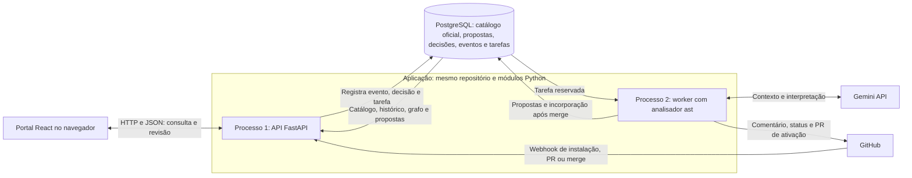
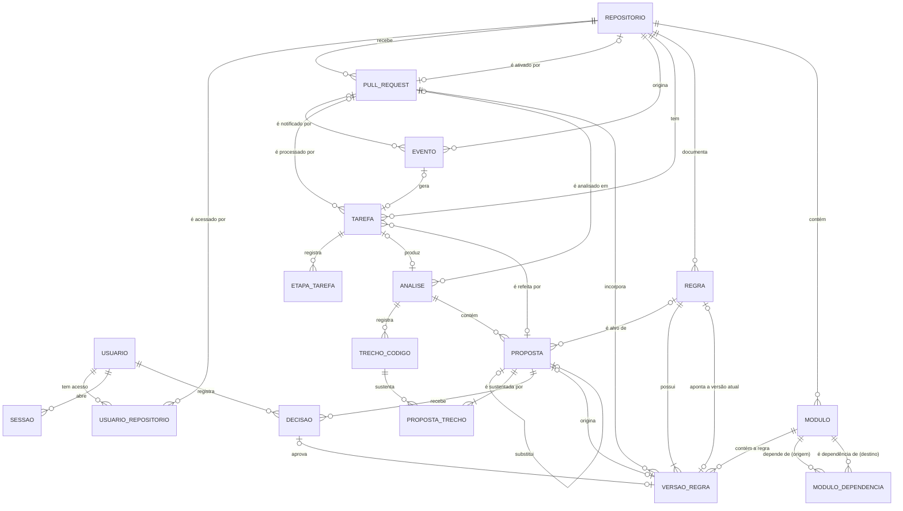

# TCC — Definição da arquitetura e implementação

Este documento consolida a arquitetura definida no [Mapa da arquitetura do TCC](<Mapa da arquitetura do TCC.md>) para implementar a aplicação de documentação viva descrita em [escopo-tcc.md](escopo-tcc.md).

As decisões são: **API e worker em Python**, **analisador como módulo importado pelo worker**, **fila de tarefas no PostgreSQL**, **um único banco**, **Gemini 3.6 Flash como IA**, **portal React para consulta e revisão das propostas, com login pelo GitHub** e **hospedagem de API, worker e PostgreSQL em uma VM do Oracle Cloud Always Free, com o portal na Vercel**. As propostas da IA ficam no banco, que é a fonte oficial do catálogo. O bot comenta no PR um resumo com link para o portal e publica um status de commit. No portal, quem tem permissão de escrita aprova, edita ou rejeita cada proposta. Uma proposta aprovada só se torna vigente quando o PR é mesclado.

Para o fluxo de revisão, esta definição adota a decisão de 10/11/2026 registrada em [requisitos.md](requisitos.md) (D1+D2): revisão no portal, com o merge como aceitação final. Essa decisão substitui a revisão no GitHub registrada anteriormente no mapa e alinha este documento ao `escopo-tcc.md` e ao Cap. 3. As demais decisões de requisitos estão na seção 6 daquele documento.

## 1. Direção da arquitetura

A aplicação será um **monólito modular com processamento assíncrono**: um processo web e um processo worker, no mesmo repositório, compartilhando módulos Python e o mesmo PostgreSQL.

| Processo | Responsabilidade |
|---|---|
| **1 — API Python/FastAPI** | Receber e validar webhooks, registrar eventos e tarefas, autenticar as pessoas no portal, disponibilizar os endpoints de consulta e registrar as decisões de revisão. |
| **2 — Worker Python** | Reservar tarefas no banco, gerar a base inicial e abrir o PR de ativação, obter versões do código, chamar o analisador, consultar o Gemini, publicar comentário e status no PR e incorporar ao catálogo as propostas aprovadas após o merge. |

O analisador será um módulo Python importado pelo worker. A coordenação da análise, a interpretação pela IA e a publicação permanecem no mesmo processo para manter a implementação compatível com o escopo do TCC.

A API e o worker se coordenam pelas tarefas e pelos dados persistidos no PostgreSQL. O portal React executa no navegador e consulta a API por HTTP/JSON. A proposta inicial é servir seu build estático pela própria API; durante o desenvolvimento, o frontend poderá ter um servidor separado.



Serão **dois processos permanentes da aplicação e uma instância PostgreSQL**. A fila será uma tabela do próprio banco. Inicialmente, um worker executará uma tarefa por vez.

Essa separação permite receber e registrar tarefas durante uma parada do worker, desde que a API e o banco estejam disponíveis. A indisponibilidade do PostgreSQL interrompe recebimento, consultas e processamento. Uma falha no worker interrompe temporariamente análise, publicação e atualização do catálogo, mas as decisões no portal continuam sendo registradas. Como o banco guarda a versão oficial do catálogo, seu backup é obrigatório. Esses limites são aceitos nesta etapa, com recuperação de tarefas e backup do banco previstos na implementação.

### Fluxo de ativação

1. A GitHub App é instalada em um repositório, e o GitHub envia o evento `installation` ou `installation_repositories`.
2. O worker gera a base inicial (grafo e catálogo inicial) a partir da branch de referência, que por padrão é a branch padrão do repositório no GitHub e pode ser trocada no portal por quem administra o repositório.
3. O worker abre o PR de ativação, que adiciona o `.lastro.yml` e traz na descrição o link para revisar o catálogo inicial no portal.
4. As regras da base são revisadas no portal como propostas desse PR. O merge do PR de ativação torna a base vigente.

### Fluxo de consulta e revisão

1. Uma pessoa abre o portal React e faz login com o GitHub.
2. O portal solicita o catálogo, o histórico, o grafo ou as propostas de um PR à API.
3. A API verifica o acesso, consulta o PostgreSQL e devolve JSON.
4. Quem tem permissão de escrita no repositório aprova, edita ou rejeita propostas. A API grava a decisão e a tarefa de atualização do status do PR na mesma transação.

### Fluxo de atualização

1. O GitHub avisa que um PR foi aberto ou atualizado.
2. A API valida a entrega e grava o evento e a tarefa na mesma transação.
3. O worker reserva a tarefa e analisa as versões do código com `ast`.
4. O Gemini interpreta o contexto e propõe a atualização das regras. As propostas validadas são gravadas no banco.
5. O worker publica no PR um comentário com o resumo das propostas e o link para a revisão no portal, além do status `lastro/documentacao`.
6. O revisor confere o código no GitHub e decide as propostas no portal.
7. O merge representa a aceitação final. Um novo evento gera a incorporação das propostas aprovadas ao catálogo.

## 2. Tecnologias definidas e propostas de implementação

| Parte | Tecnologia | Responsabilidade |
|---|---|---|
| Linguagem do servidor | Python estável mais recente | Executar API, worker e analisador, com versão fixada para reproduzir os experimentos. |
| API — processo 1 | FastAPI | Receber webhooks, atender as consultas do portal e registrar as decisões de revisão. |
| Worker — processo 2 | Python | Consultar a fila no banco e executar o pipeline de análise, publicação e incorporação. |
| Análise estática | Biblioteca padrão `ast` | Extrair estrutura, comparar versões, identificar dependências e selecionar contexto. |
| Acesso às versões | Git e API do GitHub | Obter arquivos, commits e informações dos PRs. |
| Integração com IA | Gemini 3.6 Flash pela Gemini API, com adaptador Python | Preparar requisições, tratar falhas e validar respostas estruturadas. |
| Persistência | Uma instância PostgreSQL com um banco + SQLAlchemy | Armazenar a versão oficial do catálogo e seu histórico, eventos, tarefas, análises, propostas, decisões e métricas. |
| Fila de processamento | Tabela `tarefas` no PostgreSQL | Reservar trabalho, controlar tentativas e recuperar tarefas interrompidas. |
| Portal | React; Vite proposto para desenvolvimento e build | Consultar catálogo, histórico e grafo e revisar as propostas. |
| Visualização do grafo | Cytoscape.js | Apresentar dependências e módulos envolvidos nas mudanças. |

O [SQLAlchemy](https://docs.sqlalchemy.org/en/20/orm/quickstart.html) será utilizado pelos dois processos, com os mesmos modelos e uma única sequência de migrações. Registrar evento e tarefa na mesma transação elimina a janela entre persistir o recebimento e encaminhar o trabalho a outra infraestrutura.

O [guia do React apresenta o Vite como uma opção de build](https://react.dev/learn/build-a-react-app-from-scratch). Os arquivos gerados serão publicados na Vercel, que encaminha as chamadas `/api` e `/auth` à API e devolve o `index.html` nas rotas da SPA (seção 4). O grafo utilizará [Cytoscape.js](https://js.cytoscape.org/).

A fila no banco atende à proposta inicial de um worker e poucos tipos de tarefa. Essa escolha reduz a infraestrutura, mas exige implementar reserva, tentativas, recuperação e acompanhamento das tarefas. Seu comportamento será verificado antes dos experimentos.

## 3. Núcleo de análise com `ast`

### Versão da aplicação e código analisado

API, worker e analisador usarão a **versão estável mais recente do Python**, com a versão exata e as dependências fixadas no ambiente. Na consulta de **29/10/2026**, a versão disponível é o **Python 3.15.2**, publicado em 25/10/2026. A compatibilidade das bibliotecas será verificada na implementação. [Downloads oficiais do Python](https://www.python.org/downloads/) e [Python 3.15.2](https://www.python.org/downloads/release/python-3152/).

Os repositórios analisados terão como alvo **Python 3**. A versão usada para executar a ferramenta é diferente da versão do projeto analisado: o código será lido como texto, sem instalar ou executar suas dependências.

**A política de compatibilidade está definida:** usar o `ast` da versão instalada para analisar código da versão atual e de versões anteriores do Python 3, desde que a sintaxe seja aceita e as estruturas sejam tratadas pelo analisador.

Isso não garante suporte automático a toda versão desde a 3.0: uma sintaxe antiga pode ter deixado de ser aceita. O `ast.parse(feature_version=...)` permite tentar uma gramática anterior dentro dos limites do runtime, sem reproduzir exatamente o parser original. O código será submetido ao parser; incompatibilidades ou estruturas não tratadas serão registradas como limitação e análise incompleta, sem serem classificadas como ausência de mudança de negócio. Os testes documentarão os casos aceitos por essa política. [Compatibilidade do parser `ast`](https://docs.python.org/3/library/ast.html#ast.parse).

### Etapas da análise

A biblioteca `ast` transforma o texto do código em uma árvore de sintaxe abstrata. O analisador poderá identificar funções, classes, condições, chamadas, retornos e importações sem executar o projeto. [Documentação do `ast`](https://docs.python.org/3/library/ast.html).

1. **Extração:** identificar módulos, funções, métodos, classes e referências.
2. **Comparação:** localizar inclusões, remoções e alterações estruturais entre as versões.
3. **Seleção de contexto:** reunir código anterior e novo, regras existentes e dependências relevantes.
4. **Interpretação pelo Gemini:** avaliar se existe mudança de negócio e propor a atualização correspondente.
5. **Validação:** conferir o formato da resposta e suas referências ao código.

O núcleo estático será um módulo Python comum, com entradas e resultados estruturados, importado pelo worker e reutilizável pelo terminal e pelo replay. O módulo receberá versões de código e documentação existente; acesso ao GitHub, persistência e chamadas ao Gemini ficarão nos adaptadores coordenados pelo pipeline.

### Exemplo

Código anterior:

```python
if valor_compra >= 100:
    desconto = 0.10
```

Código alterado:

```python
if valor_compra >= 150:
    desconto = 0.10
```

A comparação identifica a troca de `100` por `150` na condição. O Gemini recebe os trechos e a regra existente e pode propor:

> O desconto de 10% passa a ser concedido para compras a partir de R$ 150.

A análise também precisa considerar alterações fora das funções, como constantes e importações. Uma função pode manter o texto e mudar de comportamento porque uma constante utilizada por ela foi alterada.

### Limites da análise estática

O `ast` não determina sozinho o significado de negócio de uma alteração nem resolve todas as dependências de Python. A proposta é construir um grafo de importações e chamadas resolvidas estaticamente, registrando as relações desconhecidas como limitação.

Uma dependência indica possível impacto, mas não comprova mudança de regra de negócio. Uma alteração estrutural também pode representar uma refatoração sem mudança de comportamento. A interpretação da IA continuará sujeita à revisão humana e à avaliação do TCC.

## 4. Integração com o GitHub e processamento assíncrono

### GitHub App

A integração será feita por uma **GitHub App**, instalada nos repositórios acompanhados e autorizada a consultar código, abrir o PR de ativação, comentar nos PRs e publicar status de commit.

- **Webhook:** informa à API que um evento aconteceu.
- **API do GitHub:** permite ao worker obter versões, consultar PRs e publicar os resultados.

O GitHub apresenta esse fluxo em seu [tutorial de aplicação que responde a webhooks](https://docs.github.com/en/apps/creating-github-apps/writing-code-for-a-github-app/building-a-github-app-that-responds-to-webhook-events).

### Eventos acompanhados

| Evento e ação | Tratamento |
|---|---|
| `installation` (`created`) ou `installation_repositories` (`added`) | Criar uma tarefa `gerar_base` para cada repositório incluído. |
| `pull_request` `opened` | Criar a tarefa `analisar_pr` para a versão recebida. Se o repositório ainda não estiver ativo, a tarefa apenas comenta que a base está em revisão. |
| `pull_request` `synchronize` | Criar `analisar_pr` para a nova versão do código. |
| `pull_request` `reopened` | Verificar a versão atual e criar `analisar_pr` quando necessário. |
| `pull_request` `closed` com `merged: true` | Criar `pr_mergeado` para incorporar as propostas aprovadas. No PR de ativação, isso torna a base vigente. |
| `pull_request` `closed` sem merge | Registrar o encerramento, descartar as tarefas pendentes e as decisões tomadas e manter o catálogo vigente. |
| `pull_request` com destino diferente da branch de referência | Registrar com `motivo_ignorado`, sem tarefa nem comentário. O catálogo descreve uma única branch. |

Os eventos e seus campos estão na [documentação de payloads do GitHub](https://docs.github.com/en/webhooks/webhook-events-and-payloads).

O PR de ativação é aberto pelo próprio bot. Seus eventos `opened` e `synchronize` são registrados com `motivo_ignorado`, sem tarefa de análise, porque as propostas desse PR vêm da tarefa `gerar_base`. A exceção é um `synchronize` que altera o `.lastro.yml`: ele cria uma nova `gerar_base` com a configuração alterada. O PR é identificado por `repositorios.pull_request_ativacao_id`. Como o bot não faz commits nos PRs dos desenvolvedores, não há ciclo de análises a evitar.

### Recebimento transacional

1. O GitHub envia a requisição para `POST /webhooks/github`.
2. A API valida a assinatura, identifica a instalação, o repositório, a ação, o PR e os commits envolvidos.
3. Em **uma única transação PostgreSQL**, registra o evento e cria a tarefa correspondente, com uma restrição de unicidade para `X-GitHub-Delivery` no registro do evento. Eventos ignorados também podem ser registrados com o motivo, sem gerar tarefa.
4. Depois do commit da transação, responde com sucesso ao GitHub. Uma entrega já persistida é reconhecida sem criar outra tarefa.

Se a transação falhar, evento e tarefa não serão confirmados e a API retornará falha. Se a resposta se perder depois do commit, o reenvio será deduplicado. O recebimento deve terminar em até dez segundos, sem executar AST ou chamadas à IA na requisição. [Boas práticas para webhooks](https://docs.github.com/en/webhooks/using-webhooks/best-practices-for-using-webhooks).

O GitHub **não reenvia automaticamente entregas com falha**. Inicialmente, será previsto reenvio manual e conferência das entregas; a automação da reconciliação poderá ser acrescentada aos processos existentes. [Tratamento de entregas com falha](https://docs.github.com/en/webhooks/using-webhooks/handling-failed-webhook-deliveries).

### Fila no PostgreSQL

A tabela `tarefas` armazenará o tipo de operação, o evento de origem, o repositório, o PR, os commits, o estado de processamento, as tentativas e os erros. A estrutura abaixo é uma referência para a implementação. As demais tabelas estão na seção 7.

| Tipo | Origem | O que faz |
|---|---|---|
| `gerar_base` | Evento de instalação ou comando de terminal | Gera a base inicial e abre o PR de ativação. |
| `analisar_pr` | Evento de PR | Analisa a versão do PR e publica comentário e status. |
| `reanalisar_proposta` | Decisão "refazer" no portal | Pede ao Gemini uma nova proposta com o motivo do revisor. |
| `atualizar_status` | Decisão no portal | Atualiza o status `lastro/documentacao` do PR. |
| `pr_mergeado` | Evento de merge | Incorpora ao catálogo as propostas aprovadas. |

```sql
CREATE TABLE tarefas (
    id              bigserial PRIMARY KEY,
    evento_id       bigint UNIQUE REFERENCES eventos (id),        -- nulo nas tarefas criadas pelo portal ou pelo terminal
    repositorio_id  bigint NOT NULL REFERENCES repositorios (id),
    pull_request_id bigint REFERENCES pull_requests (id),         -- nulo em 'gerar_base' até o PR de ativação existir
    proposta_id     bigint REFERENCES propostas (id),             -- preenchido em 'reanalisar_proposta'
    tipo            text NOT NULL, -- 'gerar_base' | 'analisar_pr' | 'reanalisar_proposta' | 'atualizar_status' | 'pr_mergeado'
    commit_sha      text,
    base_sha        text,
    status          text NOT NULL DEFAULT 'pendente',
    tentativas      integer NOT NULL DEFAULT 0,
    disponivel_em   timestamptz NOT NULL DEFAULT now(),
    iniciado_em     timestamptz,
    reserva_ate     timestamptz,
    reserva_token   uuid,
    erro            text,
    criado_em       timestamptz NOT NULL DEFAULT now(),
    concluido_em    timestamptz
);

CREATE INDEX tarefas_pendentes_idx
    ON tarefas (disponivel_em, id)
    WHERE status = 'pendente';

-- Reservar uma tarefa em uma transação curta e confirmar imediatamente.
UPDATE tarefas AS tarefa
SET status = 'processando',
    iniciado_em = now(),
    tentativas = tarefa.tentativas + 1,
    reserva_ate = now() + interval '5 minutes',
    reserva_token = gen_random_uuid()
WHERE tarefa.id = (
    SELECT id
    FROM tarefas
    WHERE status = 'pendente'
      AND disponivel_em <= now()
    ORDER BY disponivel_em, id
    LIMIT 1
    FOR UPDATE SKIP LOCKED
)
RETURNING tarefa.*;
```

O worker consultará periodicamente as tarefas disponíveis, com intervalo configurável quando a fila estiver vazia (padrão: 5 s). A reserva usa `FOR UPDATE SKIP LOCKED`, que permite pular linhas já bloqueadas por outro consumidor. A transação será encerrada antes da análise e das chamadas externas. O PostgreSQL documenta esse uso para tabelas que funcionam como filas. [Bloqueio de linhas e `SKIP LOCKED`](https://www.postgresql.org/docs/current/sql-select.html#SQL-FOR-UPDATE-SHARE).

Os estados previstos são `pendente`, `processando`, `concluida`, `erro` e `descartada`. A conclusão será registrada no banco junto aos resultados da etapa. A unicidade de `delivery_id` em `eventos` e de `evento_id` em `tarefas`, com tratamento de conflito na inserção, impedirá a criação de outra tarefa para a mesma entrega. As tarefas criadas por decisões no portal (`reanalisar_proposta` e `atualizar_status`) não têm evento; a API as grava na mesma transação da decisão.

### Recuperação de falhas e novas tentativas

| Situação | Comportamento esperado |
|---|---|
| Entrega repetida | Reconhecer o evento existente e manter a tarefa já criada. |
| Worker cai durante a execução | Recuperar a tarefa após expirar a reserva, retomando as etapas ainda necessárias. |
| Análise salva, mas publicação falha | Reutilizar o resultado persistido e tentar novamente a publicação. |
| Comentário, status ou PR de ativação criado, mas resposta ou registro local se perde | Consultar o GitHub e reconhecer a publicação antes de criar outra. |
| Gemini ou GitHub indisponível | Reagendar com `disponivel_em`: até 5 tentativas, com espera de 30 s, 1, 2, 4 e 8 min, ou o `Retry-After` informado pelo serviço. |
| Limite esgotado | Marcar como `erro`, preservar o histórico e permitir reprocessamento operacional após a correção. |
| PR atualizado ou fechado durante a análise | Conferir o estado atual antes de publicar e descartar ou substituir o trabalho obsoleto. |

A reserva terá prazo e identificação da tentativa. O worker deverá renová-la enquanto estiver ativo; na inicialização e periodicamente, verificará reservas expiradas para reagendar tarefas ou marcá-las como `erro` quando o limite de tentativas tiver sido atingido. Atualizações de conclusão e renovação devem conferir `reserva_token` e o estado atual, para que uma execução antiga não conclua uma tarefa já retomada. A reserva dura 5 minutos e é renovada a cada 1 minuto enquanto o worker estiver ativo. Esses valores são configuráveis.

O banco e o GitHub não participam da mesma transação. Por isso, o processamento deve tolerar repetição. A deduplicação da análise considerará repositório, PR, commits comparados e configuração da execução; a publicação terá identificação estável vinculada à análise e ao commit de origem. O recálculo de uma proposta rejeitada (`reanalisar_proposta`) fica fora dessa deduplicação e é vinculado à proposta que substitui.

As etapas e tentativas ficarão registradas no PostgreSQL, na tabela `etapas_tarefa`. Esse histórico permitirá acompanhar recebimento, análise, chamadas ao Gemini, publicação, erros e incorporação após o merge.

### Autenticação e permissões

O worker usará a chave privada do GitHub App para solicitar um token de instalação e atuar nos repositórios autorizados. [Autenticação da instalação](https://docs.github.com/en/apps/creating-github-apps/authenticating-with-a-github-app/authenticating-as-a-github-app-installation).

As permissões previstas são:

- **Contents — leitura e escrita:** obter o código. A escrita é usada apenas para criar a branch e o `.lastro.yml` do PR de ativação.
- **Pull requests — leitura e escrita:** consultar PRs, abrir o PR de ativação e publicar comentários.
- **Commit statuses — leitura e escrita:** publicar o status `lastro/documentacao` no head do PR. [API de status de commit](https://docs.github.com/en/rest/commits/statuses).

Comentários gerais de PR utilizam as operações de comentários de issues. [API de comentários](https://docs.github.com/en/rest/issues/comments).

O bot não escreve nas branches dos PRs dos desenvolvedores, então PRs de forks e branches protegidas seguem o fluxo normal: o código é lido e o comentário e o status são publicados no repositório principal. Isso deve ser confirmado no incremento 4.

O portal permitirá consultar e revisar propostas, e exigirá login com a conta do GitHub, conforme a seção 7. Cada pessoa verá apenas os repositórios da instalação aos quais tem acesso, e só quem tem permissão de escrita no repositório poderá registrar decisões. Segredos do GitHub, do Gemini e do banco permanecerão nos componentes do servidor.

### Desenvolvimento local e hospedagem

No desenvolvimento, os webhooks poderão ser encaminhados para a API local com uma ferramenta como a utilizada no [tutorial oficial do GitHub](https://docs.github.com/en/apps/creating-github-apps/writing-code-for-a-github-app/building-a-github-app-that-responds-to-webhook-events). Em operação contínua, a API precisará de um endereço público HTTPS.

A hospedagem foi definida em 11/11/2026 (D13) e usa dois provedores:

- **Oracle Cloud Always Free:** uma VM Arm (Ampere A1) com 2 OCPUs e 12 GB de memória, dentro da cota gratuita de 1.500 OCPU·h e 9.000 GB·h por mês. Ela roda a API, o worker e o PostgreSQL como processos separados, com reinício automático em caso de falha. O **Caddy** fica na frente da API e emite e renova o certificado HTTPS (Let's Encrypt), o que exige um domínio ou subdomínio apontando para a VM.
- **Vercel:** publica o build estático do portal. Um *rewrite* encaminha `/api/*` e `/auth/*` à API na VM e devolve o `index.html` nas demais rotas. Para o navegador, portal e API ficam na mesma origem, o que mantém o cookie de sessão `SameSite=Lax`, a proteção contra CSRF e o callback do OAuth sem CORS.

A VM não suspende por inatividade, então a API responde aos webhooks dentro do prazo do GitHub, ao contrário dos serviços web gratuitos que hibernam. Como o banco é a fonte oficial (RN-07), o backup é um `pg_dump` diário enviado ao Object Storage da Oracle, com a restauração testada ao menos uma vez antes dos experimentos.

Riscos conhecidos: a criação de instâncias A1 pode falhar por falta de capacidade na região, e a Oracle pode recuperar instâncias Always Free ociosas. Para evitar a recuperação, a conta será convertida para *Pay As You Go*, que não gera cobrança enquanto o uso ficar dentro da cota gratuita. As dependências do projeto precisam ter pacotes para arm64 no Python 3.15, o que será conferido na primeira implantação. Nada disso afeta o replay, que roda no terminal.

No desenvolvimento do React em outra origem, será necessário configurar encaminhamento à API ou [CORS](https://fastapi.tiangolo.com/tutorial/cors/).

## 5. Uso de LLM com Gemini

A IA escolhida é o **Gemini 3.6 Flash**, acessado pela Gemini API com o identificador `gemini-3.6-flash`, listado no [catálogo oficial de modelos](https://ai.google.dev/gemini-api/docs/models). A escolha do modelo está resolvida. O piloto utilizará esse modelo para avaliar qualidade, consumo e tempo e calibrar a configuração; suas cotas e o protocolo do piloto ainda serão definidos.

O nível gratuito dá acesso limitado a determinados modelos. Suas cotas precisam ser confrontadas com o volume previsto para o replay histórico. As condições estão nas páginas de [preços](https://ai.google.dev/gemini-api/docs/pricing) e [limites do Gemini](https://ai.google.dev/gemini-api/docs/rate-limits).

No nível gratuito, o conteúdo pode ser utilizado para melhorar os produtos. Essa condição deverá ser considerada se o estudo de caso envolver código privado. [Condições da API](https://ai.google.dev/gemini-api/docs/pricing).

### Adaptador de IA

O pipeline terá uma interface Python para interpretar mudanças, com o código específico do Gemini em um adaptador. Esse adaptador preparará a requisição, tratará erros e validará a resposta estruturada, contendo:

- Existência ou ausência de mudança de regra de negócio.
- Regras afetadas e referências ao código que sustentam a proposta.
- Tipo de atualização: inclusão, alteração ou remoção.
- Texto proposto para a documentação e justificativa.

Conferir formato e referências não comprova a corretude semântica da resposta. As propostas serão revisadas no portal e avaliadas pelo protocolo do TCC.

Quando o revisor rejeita uma proposta e pede para refazê-la, a nova requisição inclui o contexto original, a proposta rejeitada e o motivo informado. O limite é de 3 recálculos por proposta.

### Consumo e reprodução dos experimentos

Serão enviados os trechos alterados e o contexto relevante: a unidade nas duas versões, as regras vinculadas a ela e as unidades vizinhas de um nível no grafo (quem chama e quem é chamado), com suas regras. A profundidade de um nível é fixa. Cada execução registrará modelo, versão do prompt, parâmetros, tokens e tempo. As chamadas terão tempo limite e novas tentativas controladas pela tarefa.

Modelo e configuração serão mantidos consistentes nas comparações. Mudanças deverão ser registradas para permitir interpretar os resultados.

## 6. Armazenamento, revisão e versionamento da documentação

O **PostgreSQL será a fonte oficial da documentação**. Ele guarda o catálogo vigente, todas as versões das regras, as propostas originais, as decisões dos revisores e os dados de operação da ferramenta.

| Local | Conteúdo |
|---|---|
| PostgreSQL | Catálogo vigente e histórico das versões, propostas originais, decisões, eventos, tarefas, etapas, análises, trechos de código e métricas. |
| Repositório analisado | Apenas o arquivo de configuração `.lastro.yml`, adicionado pelo PR de ativação. A exportação do catálogo em JSON e Markdown para o repositório fica como desejável (`requisitos.md`, RF-DOC-03). |

### Ativação e base inicial

A tarefa `gerar_base` lê a branch de referência, gera o grafo e o catálogo inicial e abre o **PR de ativação** ("Lastro: base inicial"). Esse PR adiciona o `.lastro.yml` com a configuração usada na geração e traz na descrição o resumo do catálogo inicial e o link para revisá-lo no portal. A análise da base fica vinculada a esse PR, e suas regras são propostas de inclusão.

As propostas da base são revisadas como as de qualquer PR, com a opção de aprovar todas de uma vez. O merge do PR de ativação marca o repositório como ativo e torna a base vigente. Até lá, os demais PRs não são analisados e recebem apenas um comentário com link. Se o PR de ativação for fechado sem merge, o repositório passa à situação `inativo`. A reativação pode ser pedida pelo portal, por quem tem permissão de escrita no repositório, ou pelo terminal; nos dois casos, uma nova tarefa `gerar_base` gera outra base e abre um novo PR de ativação.

### Configuração do repositório (D18)

**Branch de referência.** Cada repositório acompanha uma única branch, guardada em `repositorios.branch_referencia`. O padrão é a branch padrão do GitHub; quem tem permissão de administração no repositório pode escolher outra no portal (por exemplo, `develop` ou `staging`). Só PRs com destino a essa branch são analisados, e só merges nela são incorporados. A troca gera uma nova base e um novo PR de ativação na nova branch; um PR de ativação aberto é fechado pelo bot, sem marcar o repositório como `inativo`. O catálogo anterior continua disponível para consulta até o merge do novo PR de ativação. A branch fica no banco, e não no `.lastro.yml`, porque a base é gerada antes de o arquivo existir e porque o arquivo é lido da própria branch de referência. Acompanhar várias branches, com um catálogo por branch, fica como trabalho futuro.

**Arquivo `.lastro.yml`.** Guarda o que delimita o código analisado:

```yaml
versao: 1
raizes:                  # onde está o Python; padrão: o repositório inteiro
  - backend/src
ignorar:
  testes:                # substitui o padrão do D6
    - "tests/**"
    - "**/test_*.py"
    - "**/*_test.py"
    - "**/conftest.py"
  caminhos:              # migrações, scripts, código gerado
    - "backend/src/**/migrations/**"
    - "**/*_pb2.py"
dominio:                 # opcional, entra no prompt
  descricao: "Sistema de matrícula e cobrança de uma escola de idiomas."
  idioma: pt
```

Só arquivos `.py` são analisados, sem configuração: num repositório com Python e TypeScript, o restante é ignorado. As raízes delimitam a busca e definem o nome dos módulos (`backend/src/lastro/pedidos.py` → `lastro.pedidos`). Modelo, prompt, cotas e limites de contexto ficam na configuração do servidor, para que o repositório não altere as condições do experimento nem o consumo da cota.

Cada análise usa o `.lastro.yml` do commit base do PR, de modo que uma mudança no arquivo só vale depois do merge; a configuração usada é registrada em `analises.configuracao`. Sem arquivo, valem os padrões. Arquivo inválido faz a análise falhar sem novas tentativas, com status `error` e explicação no comentário. Regras vigentes de arquivos que passam a ser ignorados continuam no catálogo, mas deixam de ser acompanhadas. No replay, a branch e a configuração são passadas pelo comando de terminal e mantidas fixas em toda a sequência.

### Publicação no PR

Concluída a análise, o worker grava as propostas validadas e publica no PR:

- **Comentário:** resumo das regras incluídas, alteradas e removidas, as unidades de código correspondentes e o link para a tela de revisão do PR no portal. Em novas análises do mesmo PR, o mesmo comentário é atualizado.
- **Status de commit `lastro/documentacao`** no head analisado: `pending` enquanto houver propostas pendentes; `success` quando todas forem decididas ou quando não houver mudança de regra; `error` quando a análise falhar. O dono do repositório pode torná-lo obrigatório na proteção da branch para bloquear o merge sem revisão. [Branches protegidas](https://docs.github.com/en/repositories/configuring-branches-and-merges-in-your-repository/managing-protected-branches/about-protected-branches).

Quando não há mudança de regra, nenhuma proposta é criada e o comentário registra essa conclusão. Antes de publicar, o worker confere se o PR continua aberto e se o head ainda é o analisado; se não for, o resultado fica registrado, mas não é publicado.

### Revisão no portal

Na tela de revisão do PR, quem tem permissão de escrita no repositório decide cada proposta:

| Decisão | Efeito |
|---|---|
| Aprovar | A proposta será incorporada no merge. |
| Editar | O revisor altera título e descrição e aprova. A versão incorporada é marcada `editada_por_humano`. |
| Rejeitar e descartar | A proposta não é incorporada (não é mudança de regra). |
| Rejeitar e refazer | O revisor informa o motivo, e a tarefa `reanalisar_proposta` gera uma nova proposta que substitui a anterior. O limite é de 3 recálculos por proposta. |

Cada decisão registra autor, data, tipo e texto final ou motivo, e gera uma tarefa `atualizar_status`. Decisões concorrentes sobre a mesma proposta são detectadas pelo número sequencial da decisão: a segunda é recusada, e a tela é recarregada.

A aprovação não altera o catálogo vigente. **Aprovação no portal mais merge é a aceitação**: uma proposta aprovada só se torna vigente quando o PR é mesclado. Se o PR receber novos commits, a nova análise mantém as decisões sobre unidades cujo código não mudou entre as duas versões; as demais propostas voltam para pendente, com a decisão anterior como referência.

### Incorporação após o merge

A tarefa `pr_mergeado` obterá o commit efetivamente incorporado à branch de referência (seção 6, configuração do repositório), resolvido conforme o tipo de merge (comum, squash ou rebase), e criará uma nova versão para cada regra afetada por uma proposta aprovada, com o texto editado quando houver. [Identificação do commit após o merge](https://docs.github.com/en/rest/pulls/pulls#get-a-pull-request).

A incorporação deverá ser idempotente e registrar repositório, PR, versão do código, propostas incorporadas e horário. Tarefas de merges recebidas fora de ordem poderão acrescentar versões ao histórico, mas não deverão fazer o catálogo atual retroceder; a atualização verificará a relação entre os commits da branch de referência.

Se o PR for mesclado com propostas pendentes ou com análise desatualizada (head analisado diferente do head mesclado), a aplicação registrará a inconsistência e o portal sinalizará o catálogo como defasado. Propostas pendentes de um PR já mesclado podem ser revisadas depois e, quando aprovadas, são incorporadas imediatamente. Um PR fechado sem merge preserva o catálogo vigente e descarta as decisões, que permanecem no histórico.

### Portal

O React consultará catálogo, origem das regras, histórico por PR, grafo e propostas por meio da API, e registrará as decisões de revisão. O portal indicará a versão atual do catálogo e a data da última incorporação. Se o merge já ocorreu, mas sua tarefa ainda estiver pendente ou com erro, ou se restarem propostas pendentes, a defasagem deverá ser visível.

As propostas originais, as decisões e as versões incorporadas serão preservadas separadamente para a avaliação. O replay medirá a saída automática antes da intervenção humana.

## 7. Modelo de dados

O PostgreSQL terá catorze entidades e três tabelas associativas, divididas em quatro grupos:

| Grupo | Tabelas | Papel |
|---|---|---|
| Acesso | `usuarios`, `sessoes`, `usuario_repositorio` | Login no portal, sessões e repositórios que cada pessoa pode consultar ou revisar. |
| Código e catálogo | `repositorios`, `modulos`, `modulo_dependencia`, `regras`, `versoes_regra` | Estado do código e versão oficial do catálogo. |
| Revisão | `propostas`, `proposta_trecho`, `decisoes` | Propostas originais da IA, código que as sustenta e decisões dos revisores. |
| Operação | `pull_requests`, `eventos`, `tarefas`, `etapas_tarefa`, `analises`, `trechos_codigo` | Recebimento, processamento e resultados das análises, usados na recuperação de falhas e na avaliação. |

A instalação da GitHub App não terá tabela própria: seu identificador fica em `repositorios`. A publicação no PR é registrada em `analises`, e a incorporação após o merge, em `pull_requests`, `repositorios` e `versoes_regra`.

### Autenticação

O portal exigirá login com a conta do GitHub, pelo fluxo de autorização de usuário da própria GitHub App. A ferramenta não armazenará senhas. [Autenticação em nome do usuário](https://docs.github.com/en/apps/creating-github-apps/authenticating-with-a-github-app/authenticating-with-a-github-app-on-behalf-of-a-user).

Após o login, a API consultará os repositórios da instalação acessíveis à pessoa e registrará essa relação em `usuario_repositorio`. O portal apresentará catálogo, histórico, grafo e propostas apenas desses repositórios, e a permissão será verificada novamente quando `verificado_em` tiver mais de 1 hora. [Repositórios acessíveis ao usuário](https://docs.github.com/en/rest/apps/installations#list-repositories-accessible-to-the-user-access-token).

`usuario_repositorio.permissao` registra o nível de permissão da pessoa no repositório. Só quem tem escrita pode decidir propostas, e só quem tem administração pode trocar a branch de referência; a API recusa essas operações das demais.

A sessão usa um cookie `HttpOnly`, `Secure` e `SameSite=Lax`, válido por 8 horas, o prazo do token de usuário da GitHub App. Ao expirar, a pessoa faz login novamente. O token do usuário fica cifrado em `sessoes` e nunca é enviado ao navegador. As requisições que alteram estado são protegidas contra CSRF.

### Entidades

Os campos abaixo são os principais de cada tabela; tipos, índices e campos auxiliares serão definidos nas migrações.

| Entidade (tabela) | Campos principais | Restrições e observações |
|---|---|---|
| Usuario (`usuarios`) | `id`, `github_id`, `login`, `nome`, `email`, `criado_em`, `ultimo_acesso_em` | `github_id` único. |
| Sessao (`sessoes`) | `id`, `usuario_id`, `token_cifrado`, `expira_em`, `criado_em` | O `id` vai no cookie; `token_cifrado` é o token de usuário do GitHub cifrado. |
| Acesso (`usuario_repositorio`) | `usuario_id`, `repositorio_id`, `permissao`, `verificado_em` | Chave primária (`usuario_id`, `repositorio_id`). `permissao`: `leitura`, `escrita` ou `admin`; `escrita` e `admin` decidem propostas, e só `admin` troca a branch de referência. |
| Repositorio (`repositorios`) | `id`, `github_id`, `instalacao_id`, `nome_completo`, `branch_referencia`, `situacao`, `pull_request_ativacao_id`, `commit_catalogo_atual`, `catalogo_atualizado_em`, `ativo` | `github_id` único. `branch_referencia`: branch acompanhada; por padrão, a branch padrão do GitHub. `situacao`: `gerando_base`, `em_ativacao`, `ativo` ou `inativo` (PR de ativação fechado sem merge). `commit_catalogo_atual` impede que o catálogo retroceda. |
| PullRequest (`pull_requests`) | `id`, `repositorio_id`, `numero`, `titulo`, `autor_login`, `estado`, `head_sha`, `base_sha`, `merge_commit_sha`, `aberto_em`, `fechado_em`, `incorporado_em` | Único (`repositorio_id`, `numero`). `estado`: `aberto`, `fechado` ou `mergeado`. |
| Evento (`eventos`) | `id`, `delivery_id`, `tipo`, `acao`, `repositorio_id`, `pull_request_id`, `payload`, `motivo_ignorado`, `recebido_em` | `delivery_id` único. `tipo`: `installation`, `installation_repositories` ou `pull_request`. `motivo_ignorado` preenchido quando o evento não gera tarefa. |
| Tarefa (`tarefas`) | `id`, `evento_id`, `repositorio_id`, `pull_request_id`, `proposta_id`, `tipo`, `commit_sha`, `base_sha`, `status`, `tentativas`, `disponivel_em`, `iniciado_em`, `reserva_ate`, `reserva_token`, `erro`, `criado_em`, `concluido_em` | `evento_id` único quando preenchido. Estrutura e tipos na seção 4. |
| EtapaTarefa (`etapas_tarefa`) | `id`, `tarefa_id`, `etapa`, `tentativa`, `iniciado_em`, `concluido_em`, `resultado`, `erro` | Histórico das etapas: recebimento, análise, chamadas ao Gemini, publicação e incorporação. |
| Analise (`analises`) | `id`, `pull_request_id`, `tarefa_id`, `tipo`, `base_sha`, `head_sha`, `status`, `limitacoes`, `modelo`, `versao_prompt`, `parametros`, `configuracao`, `tokens_entrada`, `tokens_saida`, `duracao_ms`, `comentario_id`, `status_publicado_em`, `criado_em` | Único (`pull_request_id`, `base_sha`, `head_sha`, `modelo`, `versao_prompt`), para deduplicar. `tipo`: `base` ou `incremental`. `pull_request_id` e `tarefa_id` são nulos em execuções do replay e do terminal. `status`: `completa` ou `incompleta`. `configuracao`: conteúdo do `.lastro.yml` usado, ou dos padrões. |
| TrechoCodigo (`trechos_codigo`) | `id`, `analise_id`, `unidade`, `arquivo`, `situacao`, `papel`, `codigo_base`, `codigo_novo`, `linha_inicio_base`, `linha_fim_base`, `linha_inicio_novo`, `linha_fim_novo` | Único (`analise_id`, `unidade`). Cópia de uma unidade de código no momento da análise. `situacao`: `adicionada`, `removida`, `alterada` ou `afetada_por_constante`. `papel`: `alterada` ou `contexto`. `codigo_base` é nulo em unidades adicionadas, e `codigo_novo`, em removidas. |
| Proposta (`propostas`) | `id`, `analise_id`, `regra_id`, `substitui_id`, `tipo`, `titulo`, `descricao`, `unidade`, `justificativa`, `criado_em` | Imutável: guarda a saída original do Gemini. `tipo`: `inclusao`, `alteracao` ou `remocao`. `regra_id` é nulo em inclusões. `substitui_id` aponta a proposta rejeitada que esta refaz. |
| Decisao (`decisoes`) | `id`, `proposta_id`, `numero`, `usuario_id`, `tipo`, `titulo`, `descricao`, `motivo`, `herdada_de_id`, `criado_em` | Único (`proposta_id`, `numero`), usado no controle de concorrência. `tipo`: `aprovada`, `editada`, `descartada` ou `refazer`. A decisão mais recente define a situação da proposta. `herdada_de_id` indica a decisão copiada de uma análise anterior do mesmo PR, quando a unidade não mudou. |
| Referência (`proposta_trecho`) | `proposta_id`, `trecho_id` | Chave primária (`proposta_id`, `trecho_id`). Trechos de código que sustentam a proposta; ambos devem pertencer à mesma análise. |
| Regra (`regras`) | `id`, `repositorio_id`, `identificador`, `versao_atual_id`, `criado_em` | Único (`repositorio_id`, `identificador`). Identidade estável da regra entre versões. |
| VersaoRegra (`versoes_regra`) | `id`, `regra_id`, `numero`, `titulo`, `descricao`, `modulo_id`, `unidade`, `arquivo`, `linha_inicio`, `linha_fim`, `situacao`, `commit_sha`, `pull_request_id`, `proposta_id`, `decisao_id`, `editada_por_humano`, `incorporado_em` | Único (`regra_id`, `numero`). Conteúdo incorporado após o merge. `situacao`: `vigente` ou `removida`. `proposta_id` único quando preenchido. `decisao_id` aponta a aprovação que originou a versão. |
| Modulo (`modulos`) | `id`, `repositorio_id`, `nome_qualificado`, `caminho`, `commit_sha`, `ativo` | Único (`repositorio_id`, `nome_qualificado`). Módulos removidos são marcados como inativos, sem exclusão, para preservar as versões antigas das regras. |
| Dependência (`modulo_dependencia`) | `origem_id`, `destino_id`, `tipo` | Chave primária (`origem_id`, `destino_id`, `tipo`). `tipo`: `importacao` ou `chamada`. |

A comparação entre `propostas`, `decisoes` e `versoes_regra` mostra o que a IA propôs, o que o revisor decidiu e o que foi incorporado. Essa separação sustenta a avaliação descrita na seção 6.

`trechos_codigo` registra as unidades alteradas e as unidades de contexto exatamente como foram enviadas ao Gemini. Com isso, o histórico do portal pode mostrar o código anterior e o novo que motivaram cada versão de uma regra, seguindo `versoes_regra` → `propostas` → `proposta_trecho` → `trechos_codigo`, e o replay pode reproduzir cada resposta sem consultar o GitHub. A verificação de que a proposta cita unidades existentes passa a ser garantida por chave estrangeira. O texto do código é copiado para o banco; em repositórios privados, isso significa armazenar código de terceiros, o que deve constar nas limitações do estudo.

Os trechos são cópias do momento da análise e não substituem o estado atual do código usado pelo grafo. As duas informações se relacionam pelo nome qualificado da unidade.

### Relações e cardinalidades



| Relação | Cardinalidade | Implementação | Leitura |
|---|---|---|---|
| Usuario ↔ Repositorio | N:N | `usuario_repositorio` | Uma pessoa acessa vários repositórios, e um repositório é acessado por várias pessoas. |
| Usuario → Sessao | 1:0..N | `sessoes.usuario_id` | Uma pessoa pode ter sessões em vários navegadores. |
| Repositorio → PullRequest | 1:0..N | `pull_requests.repositorio_id` | Todo PR pertence a um repositório. |
| Repositorio → PR de ativação | 0..1:0..1 | `repositorios.pull_request_ativacao_id` (nulo) | Aponta o PR aberto pelo bot com a base inicial; nulo enquanto a base é gerada. |
| Repositorio → Evento | 1:0..N | `eventos.repositorio_id` | Todo evento pertence a um repositório. |
| PullRequest → Evento | 0..1:0..N | `eventos.pull_request_id` (nulo) | Um PR recebe vários eventos; eventos de instalação não estão ligados a um PR. |
| Evento → Tarefa | 0..1:0..1 | `tarefas.evento_id` (único, nulo) | Um evento gera no máximo uma tarefa; tarefas do portal e do terminal não têm evento. |
| Repositorio → Tarefa | 1:0..N | `tarefas.repositorio_id` | Toda tarefa pertence a um repositório, inclusive `gerar_base`. |
| PullRequest → Tarefa | 0..1:0..N | `tarefas.pull_request_id` (nulo) | Um PR acumula tarefas de várias versões, decisões e do merge; `gerar_base` começa sem PR. |
| Proposta → Tarefa | 0..1:0..N | `tarefas.proposta_id` (nulo) | Cada pedido de refazer gera uma tarefa `reanalisar_proposta`. |
| Tarefa → EtapaTarefa | 1:0..N | `etapas_tarefa.tarefa_id` | Cada tarefa registra suas etapas e tentativas. |
| PullRequest → Analise | 0..1:0..N | `analises.pull_request_id` (nulo) | Cada nova versão do PR pode gerar uma análise; o replay e o terminal produzem análises sem PR registrado. |
| Tarefa → Analise | 0..1:0..1 | `analises.tarefa_id` (único, nulo) | `analisar_pr` e `gerar_base` produzem no máximo uma análise; as demais não produzem; o replay produz análises sem tarefa. |
| Analise → TrechoCodigo | 1:0..N | `trechos_codigo.analise_id` | Uma análise registra as unidades alteradas e as de contexto; nenhuma quando o PR não altera código Python. |
| Analise → Proposta | 1:0..N | `propostas.analise_id` | Uma análise sem mudança de negócio não tem propostas. |
| Proposta ↔ TrechoCodigo | N:N | `proposta_trecho` | Uma proposta cita um ou mais trechos (1..N), e um trecho sustenta zero ou mais propostas (0..N). |
| Proposta → Proposta | 0..1:0..1 | `propostas.substitui_id` (nulo) | Uma proposta refeita substitui a rejeitada. |
| Proposta → Decisao | 1:0..N | `decisoes.proposta_id` | Uma proposta recebe decisões ao longo da revisão; a mais recente vale. |
| Usuario → Decisao | 1:0..N | `decisoes.usuario_id` | Toda decisão tem autor. |
| Regra → Proposta | 0..1:0..N | `propostas.regra_id` (nulo) | Uma regra recebe várias propostas ao longo do tempo; uma inclusão ainda não tem regra. |
| Repositorio → Regra | 1:0..N | `regras.repositorio_id` | O catálogo de cada repositório é independente. |
| Regra → VersaoRegra | 1:1..N | `versoes_regra.regra_id` | Uma regra só existe a partir de sua primeira versão incorporada. |
| Regra → VersaoRegra atual | 0..1:0..1 | `regras.versao_atual_id` (nulo) | Aponta a versão vigente; fica nulo apenas durante a criação da regra. |
| PullRequest → VersaoRegra | 1:0..N | `versoes_regra.pull_request_id` | Um merge pode incorporar versões de várias regras. |
| Proposta → VersaoRegra | 0..1:0..1 | `versoes_regra.proposta_id` (único, nulo) | Uma proposta aprovada origina uma versão; regras incluídas manualmente pelo revisor não têm proposta. |
| Decisao → VersaoRegra | 0..1:0..1 | `versoes_regra.decisao_id` (único, nulo) | A aprovação que originou a versão. |
| Modulo → VersaoRegra | 1:0..N | `versoes_regra.modulo_id` | Cada versão da regra pertence a um módulo; um módulo contém várias regras. |
| Repositorio → Modulo | 1:0..N | `modulos.repositorio_id` | Módulos do commit atual do catálogo. |
| Modulo ↔ Modulo | N:N | `modulo_dependencia` (`origem_id`, `destino_id`) | Um módulo importa ou chama vários outros e é usado por vários. |

`commit_catalogo_atual`, `commit_sha` e os demais SHAs são identificadores de commits do GitHub, não chaves estrangeiras. O vínculo entre regra e unidade de código é feito pelo nome qualificado em `unidade`, sem tabela própria de unidades.

O grafo é armazenado no nível de módulo. Uma aresta de `chamada` entre dois módulos indica que alguma unidade do módulo de origem chama uma unidade do módulo de destino. As dependências entre funções e métodos, necessárias para selecionar o contexto, são calculadas pelo analisador a cada análise e não são gravadas no banco. Se o desenvolvimento mostrar a necessidade de consultar ou exibir o grafo de unidades, será acrescentada uma tabela de unidades de código com suas dependências.

## 8. Organização do código e reaproveitamento

| Módulo ou componente | Responsabilidade |
|---|---|
| API | Webhooks, login pelo GitHub e endpoints de consulta e de revisão do portal. |
| Processamento | Consulta e reserva de tarefas, controle de etapas, tentativas, recuperação e histórico operacional. |
| Análise | Extração de AST, comparação de versões, dependências e seleção de contexto. |
| IA | Preparação das solicitações, adaptador Gemini e validação das respostas. |
| Documentação | Propostas, decisões de revisão, base inicial, incorporação após o merge e histórico das versões. |
| GitHub | Validação de eventos, autenticação do app, consulta de versões, abertura do PR de ativação e publicação de comentários e status. |
| Persistência | Modelos SQLAlchemy, repositórios de dados e migrações compartilhadas. |
| Portal React | Consulta do catálogo, histórico e grafo e revisão das propostas. |
| Avaliação | Replay de PRs, linhas de base e coleta de métricas. |

API e worker terão pontos de entrada distintos e reutilizarão os módulos Python do mesmo projeto. O núcleo receberá versões de código e documentação existente sem depender do recebimento de webhooks.

O pipeline também poderá ser chamado pelo terminal e pelo replay histórico. Na avaliação, executará as mesmas etapas de análise e interpretação, com publicação no GitHub desabilitada e resultados registrados para comparação com o gabarito. Como não há revisor, a base inicial e as propostas originais de cada PR são incorporadas automaticamente, sem edição, antes do PR seguinte, em um catálogo separado do catálogo real (`requisitos.md`, D19).

## 9. Ordem de implementação

1. **Analisador local:** fixar o Python, comparar duas versões pelo terminal, extrair estruturas e identificar alterações e dependências. Verificar a sintaxe dos projetos selecionados.
2. **Catálogo e Gemini:** gerar uma base inicial, integrar o Gemini 3.6 Flash, produzir propostas estruturadas e executar o piloto para avaliar o modelo e calibrar a configuração.
3. **Persistência e fila:** configurar PostgreSQL e SQLAlchemy, registrar evento e tarefa na mesma transação e implementar reserva, tentativas e recuperação do worker. Verificar duplicação de entregas, falha durante a análise e expiração de reservas.
4. **GitHub App, ativação e publicação no PR:** receber eventos de instalação e de PR, gerar a base e abrir o PR de ativação, publicar comentário e status. Verificar PRs atualizados durante a análise, novas tentativas de publicação, PRs de forks e o comentário nos PRs abertos antes da ativação.
5. **Revisão no portal e incorporação após o merge:** implementar o login pelo GitHub, a verificação da permissão de escrita, a tela de revisão (aprovar, editar, rejeitar), as tarefas `reanalisar_proposta` e `atualizar_status` e a incorporação das propostas aprovadas sem regressão do catálogo atual. Verificar decisões concorrentes, novos commits durante a revisão, fechamento sem merge, merge com propostas pendentes e diferentes formas de merge.
6. **Portal de consulta:** telas de catálogo, histórico e grafo, indicação da versão atual e da defasagem e publicação do build estático.
7. **Avaliação:** executar replay histórico e linhas de base, medindo detecção, corretude, atualização, tempo e consumo conforme o escopo.

O registro das métricas e configurações começará nas primeiras execuções. A base inicial também precisa passar pela revisão no portal e pelo merge do PR de ativação antes de ser tratada como documentação vigente; por isso, a ativação completa só funciona a partir do incremento 5.

## 10. Decisões resolvidas, esclarecimentos e pontos em aberto

Os itens respondidos foram incorporados como decisões de arquitetura. A implementação e sua validação ocorrerão nas etapas correspondentes. Quando a resposta resolve apenas parte de um item, os detalhes restantes continuam em aberto.

### 10.1. Resolvidos

- **Modelo de IA — Gemini 3.6 Flash.** O worker utilizará `gemini-3.6-flash` pelo adaptador Python. O piloto avaliará essa escolha; a seleção do modelo deixou de ser uma pendência.
- **Compatibilidade do analisador — `ast` da versão instalada.** A ferramenta analisará código da versão atual e de versões anteriores do Python 3 que esse parser aceite. Casos incompatíveis ou não tratados serão informados como limitações. A política está definida na seção 3, sem pressupor que todo código antigo seja aceito.
- **Hospedagem — Oracle Cloud e Vercel** (D13). API, worker e PostgreSQL em uma VM Arm do Oracle Cloud Always Free, com Caddy para HTTPS e `pg_dump` diário no Object Storage. Portal na Vercel, com *rewrite* de `/api` e `/auth` para a API. Detalhes e riscos na seção 4.
- **Controle de acesso — login pelo GitHub.** O portal exigirá login com a conta do GitHub e mostrará apenas os repositórios acessíveis à pessoa, conforme a seção 7.
- **Modelo de dados — catorze entidades.** Usuário, sessão, repositório, módulo, regra, versão da regra, pull request, evento, tarefa, etapa da tarefa, análise, trecho de código, proposta e decisão, com as relações e cardinalidades da seção 7.
- **Revisão no portal e banco como fonte oficial** (`requisitos.md`, D1+D2 e D8). O bot comenta e publica status no PR, sem fazer commit na branch. A revisão acontece no portal, e aprovação mais merge é a aceitação. Rejeitar significa descartar ou refazer com motivo, até 3 vezes. A edição direta de regras vigentes fica para uma versão futura. Como o bot não escreve na branch, não há conflito com edições humanas nem ciclo de análises.
- **Base inicial por PR de ativação** (D4, D15). A geração é disparada pela instalação da App ou pelo terminal. O bot abre um PR com o `.lastro.yml`, as regras da base são revisadas no portal, e o merge torna a base vigente.
- **Propostas pendentes visíveis** (D3). Resumo no comentário do PR e detalhe na tela de revisão.
- **Arquivos de teste fora da análise** (D6, provisório). Critério configurável no `.lastro.yml`.
- **Configuração do repositório** (D18). Uma branch de referência por repositório, guardada no banco, com padrão na branch padrão do GitHub e troca no portal por quem administra o repositório. O `.lastro.yml` tem `versao`, `raizes`, `ignorar.testes`, `ignorar.caminhos` e `dominio` (opcional) e é lido do commit base de cada PR. Detalhes na seção 6.
- **Contexto de um nível** (D7). Vizinhos diretos no grafo, profundidade fixa.
- **Fila** (D10). Consulta a cada 5 s, reserva de 5 min renovada a cada 1 min, até 5 tentativas com espera crescente e tabela `etapas_tarefa`.
- **Grafo no replay** (D11). Recalculado com `ast` a cada commit, sem cópia no banco.
- **Sessão** (D12). Cookie de 8 h, token cifrado no banco e reverificação da permissão a cada 1 h.
- **PRs de forks** (D9). Seguem o fluxo normal, pois o bot só lê, comenta e publica status no repositório principal. A confirmar no incremento 4.
- **Novos commits durante a revisão** (D16). As decisões sobre unidades que não mudaram são mantidas; as demais voltam para pendente.
- **Incorporação no replay** (D19). Automática: a base e as propostas originais entram no catálogo do replay sem revisão nem edição.
- **PR de ativação fechado sem merge** (D20). O repositório fica `inativo`; a reativação é pedida pelo portal ou pelo terminal e gera nova base e novo PR de ativação.
- **Granularidade do grafo — nível de módulo.** O banco e o portal trabalham com módulos e dependências entre módulos. As dependências entre funções e métodos são calculadas em memória pelo analisador para selecionar o contexto. Uma tabela de unidades de código só será acrescentada se o desenvolvimento mostrar essa necessidade.

### 10.2. Esclarecimento: ferramentas e publicação do portal React

Esse item reúne as escolhas necessárias para desenvolver as telas, buscar os dados e colocar o portal no ar:

1. **Ferramentas:** são os programas usados para desenvolver e preparar o frontend para publicação. O Vite é a proposta atual: oferece o servidor de desenvolvimento e gera o build, um conjunto de arquivos HTML, CSS e JavaScript que o navegador carrega. [Build com Vite](https://vite.dev/guide/build.html).
2. **Navegação:** define como a pessoa passa entre catálogo, histórico, grafo e revisão, inclusive ao abrir um endereço diretamente. Por exemplo, `/catalogo` e `/historico` poderiam abrir telas diferentes; esses caminhos são ilustrativos e ainda serão definidos.
3. **Consultas à API:** definem como cada tela pede seus dados ao FastAPI e apresenta carregamento, resultado ou erro. Por exemplo, ao abrir o catálogo, o React poderia chamar `GET /api/regras`; a API consultaria o PostgreSQL e devolveria JSON para a tela. Esse endpoint também é ilustrativo.
4. **Publicação do build estático:** significa disponibilizar os arquivos gerados para que o navegador possa baixá-los. Eles serão publicados na Vercel, com *rewrite* das chamadas à API (D13, seção 4). O servidor de desenvolvimento do Vite é usado durante o trabalho local; a publicação utiliza o build.

A dúvida sobre o significado do item fica esclarecida aqui. A forma de publicação foi definida (D13). A escolha final das ferramentas e das rotas continua em aberto.

### 10.3. Em aberto

Os itens abaixo correspondem à seção 6 de [requisitos.md](requisitos.md), que traz o detalhe de cada um.

- Cotas disponíveis para o Gemini 3.6 Flash e configuração do piloto (D14).
- Limite de tamanho do contexto enviado por chamada e o que cortar quando ele for excedido (D17).
- Regra de formação do `identificador` estável das regras e formato da exportação opcional do catálogo para o repositório (D5).
- Detalhes do modelo de dados: tipos, índices e migrações; procedimento de reprocessamento de tarefas em erro.
- Escolhas de implementação do React explicadas na seção 10.2: ferramentas, navegação e consultas à API.
- Procedimento de recuperação de entregas de webhook com falha (RNF-OPE-06).

O primeiro incremento será o **analisador local que compara duas versões e produz diferenças estruturais e contexto**. Em seguida, o mesmo pipeline Python integrará o Gemini para propor a atualização da documentação e será reutilizado pelo worker e pelo replay.
